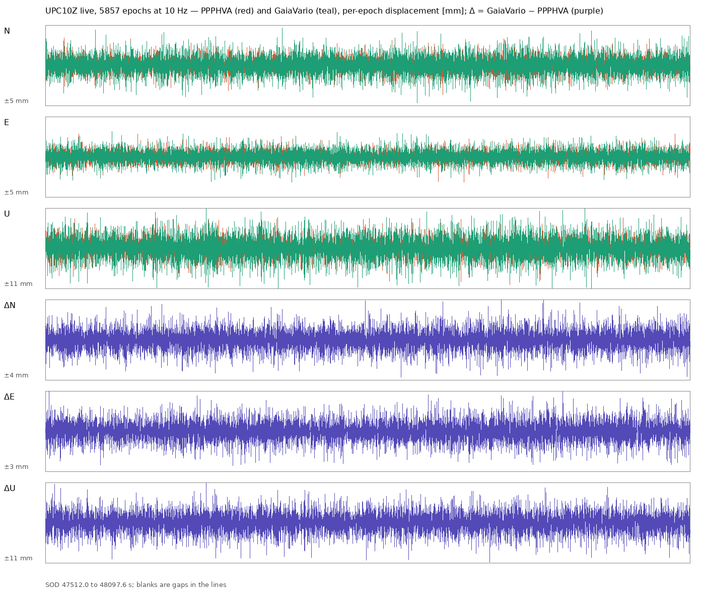

# GaiaVario versus PPPHVA on live UPC10Z data: first 10-minute comparison

Panagiotis Elias, Deforming Gaia Lab, Department of Geology, University of Patras.
Run of 2026-10-29, 15:11–15:21 UTC (GPS seconds of day 47512–48098). Development
tree `GaiaSeis_v0.4.b`, branch `dev-0.4.b`.

## 1. Purpose and scope

GaiaVario.jl is the in-house variometric engine started on 2026-10-29 as a
rewrite from the public sources (GNSS interface control documents, IERS
Conventions 2010, Niell 1996, Wu et al. 1993); PPPHVA.jl is the Julia
translation of PPPH-VA that GaiaSeis has used since 0.1 and that runs in
production. This note reports the first live comparison of the two engines on
the same observations. It grew over two days: three 10-minute runs with the
ionosphere-free observable (3.1–3.4), replayed option variants on identical
bytes (3.5–3.6), and a 14-hour overnight run with the single-frequency L1
observable through a GPS day boundary (3.7). Real ground motion is covered
by the separate shaking-table note (`GaiaVario_continuity_options_2026-10-29.md`).

## 2. Set-up

Both engines received the same bytes: the receiver stream of UPC10Z through
the local relay (`127.0.0.1:2199`, mount `B`, MSM5 at 10 Hz, GPS, GLONASS,
Galileo and BeiDou) and the BKG broadcast-ephemeris stream through the second
relay (`127.0.0.1:2198`, `BCEP00BKG0`). The receiver saw no additional client
and the production session on port 7777 and the SeedLink feed were not touched.

| | PPPHVA (via the GaiaSeis bridge) | GaiaVario |
|---|---|---|
| observable | ionosphere-free carrier phase, mode DFV | ionosphere-free carrier phase |
| constellations | G, R, E, C | G, R, E, C |
| elevation cut-off | 10° | 10° |
| signals (from the stream) | as packed by the bridge | first signal per frequency slot in message order: GPS 1C + **2W**, GLONASS 1C + 2C, Galileo 1X + 5X, BeiDou 2I + 7I (BDS-2) or 1D + 7D (BDS-3) |
| antenna model | ANTEX STHCR3-G3 | none (phase-centre terms change by micrometres between epochs) |
| troposphere | GPT3 grid + VMF3 | standard atmosphere, Saastamoinen + Niell |
| tide, wind-up | yes | yes |
| weights | engine default | sin² of elevation |
| rejection | engine 2.5 σ gate; bridge quality gate and flags | 4 robust σ (MAD of the signed weighted residuals), per satellite |
| epochs solved | 5951 of 5953 (2 blank) | 5856 of 5857 (1 blank, the first) |

The PPPHVA session ran as a GaiaSeis `NtripSession` with the production
settings and blank outputs; GaiaVario ran in the same process from a second
connection to the relays (`GaiaVario.jl/tools/compare_live.jl`). The
statistics come from `GaiaVario.jl/tools/compare_report.py`, which aligns the
two per-epoch logs by second of day.

## 3. Results

### 3.1 Per-epoch displacement noise (quiet period, no motion expected)

| component | engine | epochs | robust σ [mm] | std [mm] | max abs [mm] | epochs > 1 cm |
|---|---|---|---|---|---|---|
| N | PPPHVA | 5951 | 0.96 | 0.96 | 3.7 | 0 |
| N | GaiaVario | 5856 | 1.27 | 1.24 | 4.7 | 0 |
| E | PPPHVA | 5951 | 0.76 | 0.76 | 3.2 | 0 |
| E | GaiaVario | 5856 | 0.87 | 0.87 | 3.1 | 0 |
| U | PPPHVA | 5951 | 2.40 | 2.45 | 9.8 | 0 |
| U | GaiaVario | 5856 | 3.27 | 3.23 | 12.1 | 15 |

No epoch of either engine exceeded 5 cm; no spike of any of the four families
of the October analysis occurred in the window (none was expected: the window
contains no hour or half-hour changeover of GPS and no day boundary).

### 3.2 Agreement between the engines (5856 epochs solved by both)

| component | σ of (GaiaVario − PPPHVA) [mm] | mean [mm] | max abs [mm] | correlation |
|---|---|---|---|---|
| N | 1.03 | −0.03 | 4.1 | 0.58 |
| E | 0.73 | −0.01 | 2.7 | 0.60 |
| U | 2.85 | −0.01 | 11.9 | 0.53 |

The two engines agree in the mean to better than 0.05 mm in every component,
and no epoch differs by more than 12 mm. The correlation of about 0.55–0.60
means that roughly half of each engine's per-epoch variance is common to both
(the measurement noise they share) and half is specific to each engine.

### 3.3 Fit diagnostics of GaiaVario

- Satellites in the fit: median 32 of 32 offered (PPPHVA: 31); four systems
  in every epoch; PDOP median 1.04.
- Weighted post-fit RMS median 1.7 mm; formal σ median 1.20 / 1.00 / 3.00 mm
  (N / E / U), consistent with the empirical 1.27 / 0.87 / 3.27 mm.
- Epochs with at least one satellite rejected at 4 σ: 586 (10 %); with a
  slip-flagged satellite: 114 (2 %). At 4 σ a Gaussian residual population
  would give about 10 rejections in the whole run, so the real residuals have
  heavier tails than the sin² weight model assumes (multipath, low-elevation
  noise of the 2W signal).
- Solve time per epoch: median 0.20 ms, 95th percentile 0.69 ms, in a process
  that also ran the PPPHVA session (PPPHVA: about 2 ms after the VMF3
  memoisation of 0.4.0).

Figure: N, E, U per epoch of PPPHVA (red) and GaiaVario (teal), and the
difference GaiaVario − PPPHVA (purple), in millimetres, 5857 epochs at 10 Hz.

### 3.4 Second run with GPS L2 = 2X (13:27–13:37 UTC, 5897 common epochs)

The adapter was changed to prefer the civil codes inside a frequency slot
(GPS 2X before 2W, GLONASS 2C before 2P) and the run was repeated. Everything
else was unchanged. The two runs are at different times, so PPPHVA's own
numbers move too; the ratio GaiaVario / PPPHVA is the quantity to compare.

| component | PPPHVA σ [mm] | GaiaVario σ [mm] | ratio run 2 | ratio run 1 | σ of difference [mm] | correlation |
|---|---|---|---|---|---|---|
| N | 1.02 | 1.14 | 1.12 | 1.32 | 1.06 | 0.54 |
| E | 0.80 | 0.99 | 1.24 | 1.14 | 0.93 | 0.50 |
| U | 2.66 | 3.05 | 1.15 | 1.36 | 2.82 | 0.55 |

Mean difference again below 0.05 mm in every component; maximum single
difference 11.8 mm (U). GaiaVario used 32 satellites, PDOP 1.04, 0.23 ms per
epoch; epochs with a rejected satellite 389 (7 %, was 10 %), with a
slip-flagged satellite 240 (4 %, was 2 %: the 2X lock-time indicator resets
more often than 2W on this receiver).

The L2C choice closed about half of the gap in N and U (from +32 / +36 % to
+12 / +15 %) and nothing in E. The remaining 12–24 % is therefore not the
signal; the weight model and the frequency pairs are next (section 5).

An interactive viewer of both runs with zoom, pan and per-window σ is in
`docs/GaiaVario_vs_PPPHVA_interactive.html` (one self-contained file;
`GaiaVario.jl/tools/compare_html.py`).

### 3.5 Weight models and frequency pairs, replayed on identical bytes (run 3, 13:43–13:53 UTC)

Run 3 repeated the live comparison and recorded the relay bytes
(`logs/rtcm_raw_20261029_154332.bin`, 589 s). The recording was then replayed
through GaiaVario with one option changed at a time
(`GaiaVario.jl/tools/replay_gaiavario.jl`, `variant_table.py`); a replay of
the unchanged options reproduces the live solutions bit for bit. PPPHVA over
the same 5909 epochs: σ = 0.97 / 0.90 / 2.98 mm (N / E / U). The ratios below
are GaiaVario / PPPHVA.

| variant (one change from the base) | GaiaVario σ N / E / U [mm] | ratio N / E / U | σ of difference [mm] | sats | rejected |
|---|---|---|---|---|---|
| **base**: sin² weights, 2X, Galileo E1+E5a, BeiDou B1C+B2b or B1I+B2I | 1.11 / 1.03 / 2.90 | 1.14 / 1.15 / **0.97** | 1.01 / 1.01 / 2.21 | 31 | 0.5 % |
| weights sin(el) | 1.11 / 1.05 / 3.02 | 1.15 / 1.17 / 1.01 | 1.05 / 1.01 / 2.36 | 31 | 5.4 % |
| weights sin² capped above 30° | 1.13 / 1.09 / 3.20 | 1.17 / 1.21 / 1.07 | 1.07 / 1.04 / 2.36 | 31 | 0.3 % |
| weights sin² capped above 20° | 1.18 / 1.13 / 3.40 | 1.21 / 1.26 / 1.14 | 1.14 / 1.04 / 2.69 | 31 | 0.1 % |
| weights from C/N0 | 1.67 / 1.32 / 3.58 | 1.72 / 1.46 / 1.20 | 1.67 / 1.39 / 3.75 | 31 | 9.4 % |
| weights sin² × C/N0 | 1.81 / 1.35 / 4.19 | 1.87 / 1.49 / 1.41 | 1.82 / 1.41 / 4.27 | 31 | 0.4 % |
| Galileo E1+E5b | 1.09 / 1.03 / 2.87 | 1.12 / 1.14 / 0.96 | 1.04 / 1.04 / 2.33 | 31 | 0.4 % |
| Galileo E1+E5 (AltBOC) | 1.09 / 1.03 / 2.88 | 1.13 / 1.15 / 0.96 | 1.02 / 1.04 / 2.33 | 31 | 0.5 % |
| Galileo E1+E6 | 1.12 / 1.02 / 2.93 | 1.15 / 1.13 / 0.98 | 1.04 / 1.03 / 2.36 | 31 | 0.4 % |
| BeiDou B1I+B3I for all | 1.10 / 1.03 / 2.87 | 1.13 / 1.14 / 0.96 | **0.96 / 0.96 / 2.08** | 31 | 0.5 % |
| BeiDou B1I+B2 (B2I or B2a) | 1.14 / 1.11 / 3.02 | 1.17 / 1.24 / 1.01 | 1.03 / 1.07 / 2.12 | 28 | 0.2 % |
| BeiDou B2a before B2b | 1.10 / 1.04 / 2.87 | 1.14 / 1.15 / 0.96 | 1.01 / 1.02 / 2.18 | 31 | 0.5 % |
| GPS L1+L5 instead of L1+L2 | 1.26 / 1.13 / 3.19 | 1.30 / 1.26 / 1.07 | 1.16 / 1.10 / 2.66 | 26 | 0.4 % |
| no rejection (k = 100) | 1.11 / 1.04 / 2.92 | 1.14 / 1.15 / 0.98 | 1.01 / 1.01 / 2.21 | 31 | 0 % |
| elevation mask 15° | 1.12 / 1.03 / 2.97 | 1.15 / 1.15 / 1.00 | 1.01 / 1.02 / 2.24 | 30 | 0.5 % |
| **single frequency (L1 / E1 / B1 only)** | **0.70 / 0.58 / 2.39** | **0.72 / 0.65 / 0.80** | 0.68 / 0.67 / 1.86 | 31 | 0.4 % |

What the table says:

- **The weight model is not the cause.** sin² (the 1/sin noise model) is the
  best of the six tried; capping the weights, sin(el) and any use of C/N0 are
  worse. The receiver's reported C/N0 carries no useful weighting information
  for this purpose.
- **The frequency pairs are not the cause either.** The Galileo choices
  differ by 1 %; B1I+B3I for all BeiDou satellites improves the agreement with
  PPPHVA (difference σ down 5–6 %) at the same noise, which suggests PPPHVA
  uses that pair, and is adopted as the new default. L1+L5 is worse (fewer
  satellites).
- **Rejection and the mask do not matter** in this quiet period.
- In run 3 GaiaVario's **vertical is already at PPPHVA's level** (ratio 0.97),
  and the horizontal excess is 14–15 %. That residual is not explained by any
  option tested here; the remaining differences are inside the estimator
  (treatment of the receiver clock per constellation and the a-priori
  weights per system) and are the next thing to study.
- **Single-frequency is 20–35 % quieter than either dual-frequency engine.**
  The ionosphere-free combination multiplies the phase noise by about three,
  while the ionospheric delay changes by far less than that between two
  epochs 0.1 s apart. For 10 Hz variometric work the combination costs more
  than it removes, which agrees with the GPS-only single-frequency choice made
  for UPA10Z in 2026. The price is a slow ionospheric drift that the seismic
  band does not see but an integrated displacement would, and sensitivity to
  scintillation. Whether a multi-frequency average gains a further √2 is
  tested in section 3.6 (it does not, on this receiver).

### 3.6 Observable: ionosphere-free, single frequency, or the mean of two (run 3 replay)

A third observable was added to the engine, the plain average of the two
phases (`mode = :mean`), which keeps the single-frequency noise and would gain
√2 if the two frequencies' noise were independent. Same recording, same
5909 epochs; PPPHVA σ = 0.97 / 0.90 / 2.98 mm.

| observable | GaiaVario σ N / E / U [mm] | ratio to PPPHVA | σ of difference to PPPHVA [mm] |
|---|---|---|---|
| ionosphere-free (B1I+B3I default) | 1.10 / 1.03 / 2.87 | 1.13 / 1.14 / 0.96 | 0.96 / 0.96 / 2.08 |
| single frequency, L1 civil code (1C / 1X / 2I) | 0.70 / 0.57 / 2.36 | 0.72 / 0.64 / 0.79 | 0.67 / 0.65 / 1.78 |
| single frequency, L1 P code where present (1W) | 0.71 / 0.58 / 2.36 | 0.73 / 0.65 / 0.79 | 0.59 / 0.57 / 1.58 |
| mean of the two frequencies | 0.72 / 0.59 / 2.37 | 0.75 / 0.66 / 0.80 | 0.73 / 0.71 / 1.97 |

- **The mean brings nothing over L1 alone.** The expected √2 does not appear,
  so the per-epoch noise of L1 and L2 is strongly correlated in this receiver
  (consistent with L2 tracking aided by L1, and with the ionosphere-free
  combination being only 1.6× noisier than L1 instead of the 3× that
  independent noise would give). The dominant per-epoch noise is therefore
  common to both carriers and no frequency combination removes it.
- The L1 P-code variant has the same noise and agrees better with PPPHVA
  (difference σ down 10–12 %), which indicates PPPHVA uses the 1W/2W
  observations.

**Low-frequency behaviour.** Integrating the per-epoch displacements over the
591 s of the window (a blank epoch adds nothing):

| series | integrated N / E / U at the end [mm] | trend [mm/min] | max detrended excursion [mm] | σ of 60-s mean velocity [mm/s] |
|---|---|---|---|---|
| PPPHVA | +151 / −32 / +272 | +17.5 / −1.8 / +26.0 | 18 / 17 / 64 | 0.151 / 0.136 / 0.450 |
| GaiaVario ionosphere-free | +62 / −17 / +33 | +8.2 / 0.0 / +1.6 | 16 / 17 / 37 | 0.110 / 0.120 / 0.246 |
| GaiaVario single L1 | −117 / +12 / +69 | −10.2 / +2.6 / +6.4 | 18 / 12 / 34 | 0.103 / 0.109 / 0.204 |
| GaiaVario mean | −182 / +28 / +69 | −16.9 / +4.2 / +6.8 | 20 / 11 / 33 | 0.106 / 0.108 / 0.196 |

Every variometric series drifts by tens to hundreds of millimetres in ten
minutes; this is the known inability of the method to constrain low
frequencies, not a property of one engine. PPPHVA drifts most in this window
(+27 mm/min in U). The single-frequency series adds an ionospheric rate of
the order of 0.1–0.3 mm/s with respect to the ionosphere-free one (opposite
sign of the N trend), which is of the same size as the drift from the other
error sources. At the periods of the seismic band (below about 100 s) none of
this is visible; for an integrated displacement over minutes all of them need
the PPP-AR fusion already planned.

### 3.7 Overnight run, 29 October 17:41 to 30 October 08:00 local (14.3 h, 514 713 epochs)

Same set-up as run 3, GaiaVario in single-frequency L1 mode (`GV_MODE=single`),
through the GPS day boundary at 01:59:42 local (23:59:42 UTC). Both engines
solved 99.99 % of the epochs (PPPHVA 2 blank, GaiaVario 1).

| | PPPHVA σ N / E / U [mm] | GaiaVario L1 σ N / E / U [mm] | ratio | σ of difference | correlation |
|---|---|---|---|---|---|
| whole night | 1.03 / 0.92 / 2.34 | 0.75 / 0.69 / 1.74 | 0.73 / 0.75 / 0.74 | 0.63 / 0.58 / 1.50 | 0.78 / 0.77 / 0.75 |

Hour by hour the ratio of the vertical σ stayed between 0.68 and 0.80; there
was no hour in which the single-frequency solution was noisier than the
ionosphere-free one, by day or by night. Mean difference below 0.02 mm in every
component. GaiaVario used 31 satellites (PPPHVA 29), PDOP 0.93, 0.22 ms per
epoch, no slip flagged all night, 0.2 % of epochs with a rejected satellite.

| | epochs with abs(d) > 1 cm (N / E / U) | largest single epoch |
|---|---|---|
| PPPHVA | 0 / 1 / 46 | +7 / +21 / −49 mm at GPS second-of-day 0.0 |
| GaiaVario L1 | 0 / 0 / 0 | 9.9 mm (U) |

**GPS day boundary.** At the first epoch of the new GPS day PPPHVA produced a
one-epoch step of +7 / +21 / −49 mm (N / E / U); the epochs before and after
are normal. GaiaVario gave +0.1 / −0.3 / −2.7 mm at the same epoch. This is
the residue of spike family D (the 0.4.2 change removed the 72 km bursts of
0.4.1; a 5 cm step remains and passes the quality gate, whose step limit is
0.5 m). It is in the production stream every night at 23:59:42 UTC and is
worth a Causes entry and a fix in the bridge or the engine. GaiaVario, which
has no second-of-day arithmetic, is unaffected by construction.

**Integrated displacement over the night.** Summing the per-epoch increments,
PPPHVA drifts +12.6 m / +0.5 m / +0.5 m (N / E / U) and GaiaVario L1
+2.3 m / +4.7 m / +0.1 m in 14.3 h; detrended excursions are 0.6–2.8 m for
both. Neither series is a displacement at periods beyond minutes; this is
the variometric method, not an engine property, and the reason for the
PPP-AR fusion.

Interactive viewer of the whole night:
`docs/GaiaVario_vs_PPPHVA_overnight_interactive.html`; figure `docs/assets/GaiaVario_vs_PPPHVA_overnight_2026-10-30.png`.

### 3.8 Post-fit residuals compared like for like, and PPPHVA in single-frequency mode (run 3 replay, 30 October)

The per-epoch log now carries, for either engine, the number of satellites
kept and the post-fit RMS of their residuals, weighted (each engine's own
unit-weight figure) and unweighted (comparable across engines). The run 3
recording was replayed through the same bridge, the same epoch grouping and
the same 5950 epochs with four configurations:

| configuration | sats kept | weighted RMS [mm] (p90) | unweighted RMS [mm] (p90) | σ N / E / U per epoch [mm] | epochs abs(U) > 1 cm | σ of 10-s sums N / E / U [mm] |
|---|---|---|---|---|---|---|
| PPPHVA DFV (ionosphere-free) | 30 | 1.70 (2.20) | 2.10 (2.80) | 0.97 / 0.90 / 2.98 | 11 | 2.9 / 3.2 / 6.9 |
| GaiaVario dual (ionosphere-free) | 31 | 2.10 (2.70) | 2.60 (3.40) | 1.09 / 1.03 / 2.87 | 1 | 3.1 / 4.0 / 6.6 |
| PPPHVA SFV (L1) | 31 | 1.40 (1.90) | 1.80 (2.50) | 0.83 / 0.70 / 2.55 | 0 | 2.1 / 2.8 / 5.3 |
| GaiaVario single (L1) | 31 | 1.40 (1.80) | 1.80 (2.50) | 0.70 / 0.57 / 2.36 | 0 | 2.7 / 3.6 / 5.9 |

Agreement within an observable: GaiaVario dual − PPPHVA DFV σ 0.96 / 0.96 /
2.08 mm (correlation 0.52–0.75); GaiaVario single − PPPHVA SFV σ 0.30 / 0.27 /
0.69 mm (correlation 0.93–0.96).

- **Residuals.** With the ionosphere-free observable GaiaVario's post-fit
  residuals are 24 % larger than PPPHVA's (2.6 against 2.1 mm unweighted),
  the same excess as in the displacement noise; with L1 the two engines have
  identical residuals (1.8 mm) and agree epoch by epoch at the 0.3 mm level.
  The PPPHVA σ̂ shown in the status line (2.4 mm) is a windowed statistic of
  a different kind and must not be compared with GaiaVario's RMS.
- **PPPHVA in SFV mode** was not part of the earlier comparisons. Per epoch
  it is 15–20 % noisier than GaiaVario single, but when the increments are
  summed over 10 s it is *quieter* (2.1 / 2.8 / 5.3 against 2.7 / 3.6 /
  5.9 mm): PPPHVA's successive increments cancel better, which is the
  telescoping effect the shaking-table work found on other receivers for the
  ionosphere-free observable, now visible on the NET-G5 in L1. Switching the
  production profile from DFV to SFV would alone have removed most of the
  difference between the engines; the GPS day-boundary step would have
  remained.
- Consequences: (1) the comparison on the shaking table should be repeated
  with PPPHVA SFV; (2) GaiaVario's low-frequency behaviour in L1 is the next
  thing to improve (which satellites enter and leave the fit, and how the
  weights change between consecutive epochs), with the summed-increment
  noise as the metric, not the per-epoch σ.

## 4. Reading of the results

The sections above were written as the work progressed; this section reads
them together.

1. **GaiaVario works on real data for all four constellations.** Formal and
   empirical σ agree, the ephemeris adapter and the epoch grouping are right,
   and it solves 99.99 % of the epochs at 0.2 ms each.
2. **The noise comparison depends on the observable, not on the engine.**
   (Qualification added 30 October: every "PPPHVA" figure in sections 3.1
   to 3.7 is PPPHVA in its production DFV mode; PPPHVA in SFV mode, measured
   in 3.8 and on the shaking table, is as quiet as GaiaVario L1 and
   integrates better over 10 s.)
   With the same ionosphere-free observable as PPPHVA (runs 1–3), GaiaVario
   was 14–35 % noisier; the GPS L2C choice removed half of that, the weight
   model and the frequency pairs changed nothing, and a 14 % horizontal
   excess remained (section 3.5). With the single-frequency L1 observable
   (section 3.6 and the overnight run of section 3.7) GaiaVario is 25–27 %
   *quieter* than PPPHVA in every component and every hour of the night, and
   produced no epoch above 1 cm in 14 hours against 47 for PPPHVA. The two
   statements are not in contradiction: the ionosphere-free combination
   multiplies the receiver's phase noise by 1.6–3 while removing an
   ionospheric change that is negligible between epochs 0.1 s apart.
   GaiaVario can use L1 alone because its design does not rely on the
   combination; PPPHVA as translated runs in the dual-frequency mode.
3. **The remaining dual-frequency excess (14 % horizontal) is unexplained**
   and no longer matters for production if the L1 observable is used; it
   stays an open question about the estimator (receiver-clock and
   inter-system handling).
4. **Failure modes that motivated GaiaVario.** The overnight run covered one
   GPS day boundary and fourteen hourly GPS changeovers: PPPHVA still steps
   by 5 cm vertically at the day boundary (family D residue), GaiaVario does
   not; no changeover spike was seen in either engine. The σ̂ poisoning and
   the Galileo 10-minute family need a disturbed period to be tested.
5. **Low frequencies.** Both engines drift by metres over a night when their
   increments are summed. This is the method; the PPP-AR fusion remains the
   plan for displacement at periods beyond a minute.

## 5. Next steps

1. **Observable:** single-frequency L1 for the seismic channel (default
   `mode = :single` of GaiaVario, decided 2026-10-29; superseded on
   2026-10-30 by `:l1gf`, L1 with the smoothed geometry-free correction,
   which equals L1 in a quiet ionosphere); the ionosphere-free mode stays
   available. Confirm on a disturbed-ionosphere day.
2. **Production:** decide whether to gate the GPS day-boundary epoch in the
   bridge (one-epoch withhold at second-of-day 0.0) while PPPHVA is the
   production engine.
3. **Plug-in API** in the platform (`engine = "ppphva" | "gaiavario"`), the
   GaiaVario adapter and a private PPPHVA adapter, so both engines run from
   one decoder and one epoch grouping with side-by-side logging.
4. **48-hour dual-engine run** through the relays (two day boundaries, the
   hourly GPS and 10-minute Galileo changeovers), then the comparison report
   of the plan (section 3 of `GaiaVario_Engine_Plan.md`) and the decision on
   the production engine.
5. Open questions kept: the 14 % horizontal excess of the dual-frequency
   GaiaVario; the horizontal amplitude deficit of all engines on the
   shaking table (separate note).

## 6. Files

- `NtripClient.jl/logs/UPC10Z_cmp_20261029_151117.txt`, PPPHVA per-epoch log (SOD, satellites, dX dY dZ, clocks).
- `NtripClient.jl/logs/gaiavario_cmp_20261029_151116.csv`, GaiaVario per-epoch solutions (N E U, satellites, PDOP, RMS, formal σ, solve time, rejected and slipped satellites, clocks).
- `GaiaVario.jl/tools/compare_live.jl`, `GaiaVario.jl/tools/compare_report.py`, the run and the statistics.
- `docs/assets/GaiaVario_vs_PPPHVA_live_2026-10-29.png`, the figure.
