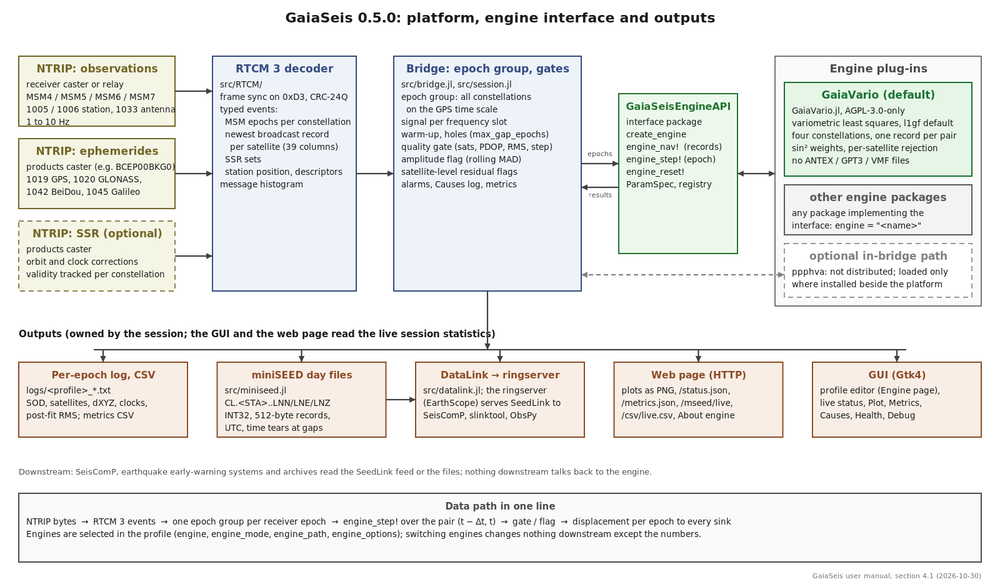

# GaiaSeis User Manual

**Version**: 0.5.0 (2026-10-30)

**Author**: Panagiotis Elias, <pelias@upatras.gr>

**Affiliation**: Deforming Gaia Lab, Department of Geology, University of Patras, Greece

**Copyright**: Copyright (C) 2026 Panagiotis Elias, Deforming Gaia Lab, Department of Geology, University of Patras

**Licence**: code GNU AGPL-3.0-only; this manual and the other documents CC BY-NC 4.0

**Repositories**: GaiaSeis (platform) <https://github.com/PanagiotisElias/GaiaSeis>;
GaiaVario.jl (default engine) <https://github.com/PanagiotisElias/GaiaVario.jl>

**Funding**: This work is part of the TRANSFORM² project (<https://www.transform2-project.eu/>) which aims to improve physical and digital infrastructure across Near-Fault Observatories (NFOs) in Europe. TRANSFORM² is funded by the European Union under project number 101188365 within the HORIZON-INFRA-2024-DEV-01-01 call.

Views and opinions expressed are however those of the author(s) only and do not necessarily reflect those of the European Union or the European Research Executive Agency (REA). Neither the European Union nor the granting authority can be held responsible for them.

> The changes of every version, from 0.1 to 0.5.0, are listed in `docs/CHANGELOG.md`.

---

## Table of contents

1. [Introduction](#1-introduction)
2. [Theoretical background: the variometric approach](#2-theoretical-background-the-variometric-approach)
   - 2.1 GNSS observation model
   - 2.2 The variometric difference
   - 2.3 Why the variometric approach for seismogeodesy?
   - 2.4 Observables: L1, ionosphere-free, L1 with geometry-free correction (l1gf)
3. [Engines](#3-engines)
   - 3.1 The plug-in architecture
   - 3.2 GaiaVario
   - 3.3 Writing a new engine
   - 3.4 Other engines
   - 3.5 Validation
   - 3.6 Licence and citation
   - 3.7 RTCM 3 messages used by the platform and by each engine
4. [System architecture](#4-system-architecture)
   - 4.1 Pipeline overview
   - 4.2 Source files and who talks to whom
5. [Embedded components in detail](#5-embedded-components-in-detail)
   - 5.1 NTRIP transport
   - 5.2 RTCM 3 decoder
   - 5.3 Ephemeris and SSR handling
   - 5.4 The engine step: variometric least squares
   - 5.5 Tropospheric delay
   - 5.6 Antenna phase centres (ANTEX)
   - 5.7 Cycle-slip detection, quality gate and amplitude flag
   - 5.8 Coordinate transforms (ECEF ↔ NEU)
   - 5.9 DOP computation
   - 5.10 Display-side filters
   - 5.11 Finite-difference (velocity / acceleration)
   - 5.12 High-pass filter (centred rolling mean)
   - 5.13 Kalman bias-removal (single-state)
   - 5.14 Decimation (stride sub-sampling)
   - 5.15 Lanczos anti-alias filter (decimation companion)
   - 5.16 Auto-flush
   - 5.17 Recommended filter stack
   - 5.18 miniSEED encoder
   - 5.19 miniSEED settings that silently break consumers, and the time scale
   - 5.21 Metrics window: comparing connections
   - 5.22 SeedLink service: ringserver fed over DataLink
   - 5.23 Satellite-level residual flags
   - 5.24 Ephemeris consistency and day wrap
   - 5.25 Residual statistics and the engine σ̂
   - 5.26 Alarms and SSR validity with broadcast fallback
   - 5.27 Engine plug-ins: configuration
6. [Data flow and sinks](#6-data-flow-and-sinks)
   - 6.1 Session lifecycle
   - 6.2 Per-stream timestamps
   - 6.3 GPS-week unwrap algorithm
   - 6.4 CSV sink format
   - 6.5 Per-session text log
   - 6.6 Plot Cairo rendering
   - 6.7 Web service
   - 6.8 Profile persistence
7. [Installation](#7-installation)
   - 7.1 Requirements
   - 7.2 Clone and instantiate
   - 7.3 Configuration file
   - 7.4 Running the GUI and the headless service
   - 7.5 SeedLink: the ringserver
   - 7.6 Building a bundle
   - 7.7 Dependencies
8. [User interface walkthrough](#8-user-interface-walkthrough)
   - 8.1 Main window layout
   - 8.2 Profile editor
   - 8.3 Live status panel
   - 8.4 Plot window
   - 8.5 Web service
   - 8.6 Metrics window
   - 8.7 Debug window
9. [Configuration reference](#9-configuration-reference)
   - 9.1 NTRIP transport (obs)
   - 9.2 GGA upload (for VRS mounts)
   - 9.3 Engine
   - 9.4 Constellations and processing
   - 9.5 SSR products caster (optional)
   - 9.6 Broadcast-ephemeris caster (optional)
   - 9.7 Logs and sinks
   - 9.8 Active profile selector
10. [Workflows / recipes](#10-workflows--recipes)
   - 10.1 A 10 Hz station end to end (worked example UPC10Z)
   - 10.2 Display settings for a high-rate station
   - 10.3 Feeding SeisComP and other consumers
   - 10.4 Live LAN monitoring
   - 10.5 Understanding the estimator
11. [Troubleshooting](#11-troubleshooting)
   - 11.1 The window stops responding (but the stream keeps running)
   - 11.2 "No solution": sno = 0 or NaN dXYZ
   - 11.3 No solution despite USABLE ≥ 5
   - 11.4 Drift at 10 Hz
   - 11.5 miniSEED files are empty
   - 11.6 A consumer reads the feed but does nothing
   - 11.7 Constant offset: every epoch biased by the same vector
   - 11.8 Pipeline falls behind: memory grows, GUI starves, then OOM
   - 11.8a Is it the stream or is it GaiaSeis? (`tools/rtcm_raw_probe.py`)
   - 11.8b OOM-killed after hours (2026-09-11 post-mortem)
   - 11.9 Memory grows steadily at 10 Hz (glibc arena fragmentation)
   - 11.10 Wrong date displayed
   - 11.11 Web server port already in use
   - 11.12 "GTK4 could not open a display"
   - 11.13 GUI doesn't open / Cairo errors
   - 11.14 `install.ps1 cannot be loaded because running scripts is disabled`
12. [References](#12-references)
13. [Acknowledgements](#13-acknowledgements)

---


## 1. Introduction

**GaiaSeis** (originally released as `NtripClient.jl`) is a real-time
GNSS streaming client that ingests
high-rate observations from NTRIP casters, decodes the RTCM 3 payload,
hands every receiver epoch to a variometric engine (the variometric
approach of Colosimo et al. 2011, chapter 2), and serves the resulting
displacement waveforms through
multiple downstream channels (live GUI plots, web service, CSV file
sink, and direct miniSEED v2 files compatible with `ringserver` /
`slarchive` / `obspy`). It is designed to monitor crustal deformation
on geodetic-quality GNSS receivers at 1 Hz to 10 Hz cadence, and is
suitable for both routine reference-frame monitoring and event-driven
seismogeodesy applications.

GaiaSeis is a **platform** with an **engine plug-in interface**
(chapter 3): the platform owns the streams, the decoder, the epoch
grouping, the quality gates and every output; the displacement itself is
computed by an engine selected in the profile. The default engine is
**GaiaVario**, a variometric engine written for this platform and
published as its own package (GaiaVario.jl). The software is the
streaming front-end of a larger research stack developed at the
Department of Geology of the University of Patras in the context of the
**TRANSFORM²** Horizon Europe project
(<https://www.transform2-project.eu/>). The software has been validated on
the GNSS stations of the University of Patras (1 Hz and 10 Hz, four
constellations) and on a public shaking-table data set (§3.5).

### Capabilities at a glance

- Up to three concurrent NTRIP connections (observations, SSR products,
  broadcast ephemerides), typical when consuming different mount points
  per data type.
- Full RTCM 3 MSM4 / MSM5 / MSM6 / MSM7 decoding (high-resolution and
  low-bandwidth variants; 10 Hz mounts are usually served as MSM5).
- SSR corrections (orbit, clock, code-bias) for GPS / GLONASS / Galileo
  / BeiDou.
- Variometric least-squares estimation by an engine plug-in
  (GaiaSeisEngineAPI). Default engine GaiaVario with the observables
  `l1gf` (L1 with the geometry-free ionospheric correction, default),
  `single` (L1), `dual` (ionosphere-free) and `mean`; four constellations,
  one broadcast record per epoch pair, per-satellite rejection.
- Drift-mitigation filters (high-pass rolling-mean, single-state Kalman,
  Lanczos anti-alias-then-decimate) with online tuning.
- Auto-flush for long-term high-rate sessions.
- Gtk4 GUI with profile editor, live status, debug dump, multi-tab plot
  window (Displacement/epoch N/E/U, Ground track, Skyplot, Residual σ̂, #sats/DOP, Latency/delays, Health).
- LAN HTTP service: same plots as PNG served over user-defined port,
  with bidirectional settings sync.
- Two miniSEED sinks: a CSV row-per-epoch (Python `obspy` / agent
  tail-and-pack) and a direct miniSEED v2 writer (`ringserver`-ready
  output, no Python required).

---

## 2. Theoretical background: the variometric approach

The variometric approach (Colosimo, Crespi and Mazzoni, 2011) estimates the
displacement of a receiver between consecutive epochs from the change of the
carrier phase, without resolving the integer ambiguities. This chapter gives
the observation model and the variometric difference; chapter 3 describes
the engines that implement it.

### 2.1 GNSS observation model

A code (pseudorange) measurement P and a carrier-phase measurement φ on
frequency f for satellite s observed by receiver r obey, after combining the
relevant clock offsets, atmospheric delays and antenna phase-centre
corrections:

```
P  = ρ + c·δtᵣ − c·δtˢ + I + T + bᵣ − Bˢ + ε_P
φ  = ρ + c·δtᵣ − c·δtˢ − I + T + λ·N + ε_φ
```

where:

- ρ: geometric range (computed from the satellite ephemeris and the receiver coordinates).
- c·δtᵣ, c·δtˢ: receiver and satellite clock offsets in metres.
- I, T: ionospheric and tropospheric path delays.
- bᵣ, Bˢ: receiver and satellite code/phase biases.
- λ·N: integer ambiguity of the phase, in metres.
- ε: measurement noise (about 1 m on code, about 3 mm on phase).

Two properties are exploited by the variometric approach:

1. **Carrier-phase noise is two to three orders of magnitude smaller than
   pseudorange noise**: about 3 mm against about 1 m at L1.
2. **The ambiguity N is constant between cycle slips**: if no slip occurs
   between epoch t and t+Δt, then N(t+Δt) = N(t) exactly.

The variometric approach uses the second property to eliminate the dominant
unknown without resolving it.

### 2.2 The variometric difference

Differencing the carrier-phase equation between two consecutive epochs t
and t+Δt (no cycle slip, the same satellite tracked):

```
Δφ = ρ(t+Δt) − ρ(t)
     + c·[δtᵣ(t+Δt) − δtᵣ(t)]
     − c·[δtˢ(t+Δt) − δtˢ(t)]
     − ΔI + ΔT + Δε_φ
```

The integer ambiguity λ·N cancels exactly. Provided that

- the **satellite ephemeris** is accurate (to compute Δρ from ρ(t) = ‖xˢ(t) − xᵣ‖),
- the **satellite clock drift** δtˢ is known (from the broadcast message or SSR corrections),
- the **ionospheric change** ΔI is small over one epoch interval, mitigated or removed (§2.4),
- the **tropospheric change** ΔT is modelled (§5.5),

the remaining unknowns at epoch t+Δt are

- the **3 components** of the receiver displacement Δxᵣ = xᵣ(t+Δt) − xᵣ(t),
- **1 receiver clock change** c·Δδtᵣ (one per constellation in a multi-GNSS solution).

Linearised about the a-priori receiver position, each satellite k gives one
observation equation

```
vₖ = −eₖ · Δxᵣ + c·Δδtᵣ + noise,
```

where eₖ is the unit line-of-sight vector from the receiver to satellite k
and vₖ the measured phase change minus the modelled change of everything
else. The design matrix therefore has one row per satellite with the three
components of −eₖ and a 1 in the clock column of that satellite's
constellation; with four unknowns (3 + 1 clock) at least five satellites are
needed to leave one degree of freedom for the residual statistics.

### 2.3 Why the variometric approach for seismogeodesy?

Compared to absolute PPP:

| Property | Absolute PPP | Variometric approach |
|---|---|---|
| Convergence time | 20–60 min before mm-level | First-epoch capable |
| Solves for | Position `x_r(t)` | Displacement increments `Δx_r(t)` |
| Ambiguity handling | Estimated / fixed (hard) | Differenced out (free) |
| Drift over time | Bounded by SSR | Random-walk grows as √N |
| Sample rate sweet spot | 30 s to 1 min | 1 to 50 Hz |
| Best use | Long-term reference frames | Transient displacements (seismic, volcanic, structural) |

The first-epoch capability of the variometric approach is the key for
earthquake early warning: a co-seismic displacement waveform can be reconstructed from
the running sum of Δx without waiting for ambiguities to converge.

The cost is **integration drift**: errors accumulate as
σ_x(t) ≈ σ_Δx · √N, so a 10-second high-rate (100 Hz) run drifts
~10× more than a 1-second one over the same wall-clock window. This
software addresses the drift with the filters described in §5.10.

### 2.4 Observables: L1, ionosphere-free, L1 with geometry-free correction (l1gf)

The variometric difference can be formed on different carrier-phase
observables. The choice decides the per-epoch noise far more than any
other setting, because every model term enters only as its change over
0.1–1 s while the measurement noise enters in full.

- **Single frequency, L1** (`single`): one carrier per satellite (L1, E1,
  B1). The quietest observable per epoch: on every receiver tested
  (Topcon NET-G5 live, and Javad, Septentrio and NET-G5 on a shaking
  table) it is 20–35 % quieter than the ionosphere-free combination, and
  on the test station UPC10Z the L1 solution of GaiaVario is 25–27 %
  quieter per epoch than the ionosphere-free solution in every component
  (`docs/GaiaVario_vs_PPPHVA_2026-10-29.md`). The price is a slow
  ionospheric drift of the integrated displacement, of the order of
  0.1–0.3 mm/s in a quiet ionosphere, which the seismic band (periods
  below about 100 s) does not see, and sensitivity to scintillation.
- **Ionosphere-free** (`dual`): the combination
  `φ_IF = (f₁² · φ₁ − f₂² · φ₂) / (f₁² − f₂²)` is formed per epoch and per
  satellite, then differenced. The first-order ionospheric term cancels
  exactly, but the phase noise is multiplied by about 3 for independent
  carriers (1.6 on receivers whose L2 tracking is aided by L1), while the
  ionospheric change between two epochs 0.1 s apart is far smaller than
  that. For 10 Hz variometric work the combination costs more than it
  removes.
- **L1 with the geometry-free correction** (`l1gf`, **the default of
  GaiaVario**): the L1 phase of each satellite is corrected with a smoothed
  rate of its geometry-free phase (L1 − L2): the ionospheric change of the
  L1 phase over an epoch is estimated from that rate (exponential average,
  time constant 30 s, history kept through gaps up to 10 s, active after
  half a time constant of continuous tracking) and added back. In a quiet
  ionosphere this is plain L1; under a strong ionospheric ramp it is 3–4
  times better than plain L1 at low frequencies and keeps the L1 precision
  in the seismic band. Satellites without a second frequency are used as
  plain L1.
- **Mean of two phases** (`mean`): the average of the two carriers. It
  would gain √2 over L1 if the noise of the two carriers were independent;
  on the receivers tested it brings nothing over L1, because the per-epoch
  noise of L1 and L2 is strongly correlated.

The observable is the profile field `engine_mode` (§5.27, §9); the optional
`ppphva` path (§3.4) selects it through `process_mode` instead.

---

## 3. Engines

### 3.1 The plug-in architecture

GaiaSeis separates the **platform** from the **engine**.

The platform (this repository) connects to the NTRIP casters, decodes the
RTCM 3 streams, groups the MSM frames of all enabled constellations into one
receiver epoch, keeps the broadcast ephemerides and the station information
(coordinates from 1005/1006 or the profile, antenna descriptor from 1033),
converts GLONASS and BeiDou time to the GPS scale, chooses the signal per
frequency slot (civil codes first: GPS `2X` before `2W`, GLONASS `2C` before
`2P`), and after the solve applies the quality gate, the amplitude flag, the
satellite flags, the Causes log and every output (per-epoch log, CSV,
miniSEED, SeedLink via ringserver, web page, GUI).

The engine receives the station, the broadcast records and each receiver
epoch and returns the displacement of the receiver over the pair of epochs
with the quality figures the platform logs, gates and publishes. An engine
is a Julia package that depends only on the small interface package
**GaiaSeisEngineAPI** (sub-package `GaiaSeisEngineAPI/` of this repository;
no GUI, no network code) and registers itself under a name.

**Call order.** The platform calls the engine in this order:

1. `create_engine(name, station, options)` once the station position is
   known. `station` is a `Station` (ECEF coordinates, antenna and receiver
   descriptors, ANTEX path if the profile gives one); `options` is a flat
   `Dict{String,Any}` built from the profile (`"mode"` from `engine_mode`,
   `"elev_mask_deg"` from `elv_cutoff_deg`, `"systems"` from the enabled
   constellations, and every `key=value` of `engine_options`).
2. `engine_nav!(eng, nav, t)` for every new or changed broadcast record,
   also before the first epoch. `nav` is a `NavRow` (system, PRN and the
   platform's 39-column record; the layout is documented in the API
   docstring).
3. `engine_step!(eng, epoch)` once per receiver epoch, in time order.
   `epoch` is an `ObsEpoch`: GPS time as (week, seconds of week) and one
   `SatObservation` per satellite with phases and codes in metres, lock-time
   indicators, half-cycle flags and C/N0 keyed by frequency slot
   (1 = L1/E1/B1, 2 = L2/B1I, 5 = L5/E5a/B2a, 6 = E6/B3I, 7 = E5b/B2b,
   8 = E5 AltBOC). It returns an `EngineResult`: dX dY dZ and dN dE dU over
   the pair, the receiver clock change per constellation, satellites offered
   and used, constellations used, PDOP, the weighted post-fit RMS, the formal
   sigmas of dNEU, one `SatLine` per satellite (elevation, azimuth, residual,
   weight, used, reason) and a `status` (`:ok`, `:first`, `:few_sats`, …).
   The first epoch and any epoch without a fit return NaN displacements.
4. `engine_reset!(eng)` when the platform decides the pairing must restart
   (a hole in the input longer than `max_gap_epochs`); the next epoch is a
   first epoch again.
5. `engine_ssr!` is optional; engines that do not use SSR keep the default
   (ignored).

**Parameters and registry.** An engine declares the parameters its
configuration page should show as a vector of `ParamSpec` (key, label, kind
`:choice`/`:float`/`:int`/`:bool`/`:text`, default, choices, range, help
text) and calls `register_engine!(:name, factory; params, description)` in
its module `__init__`. The platform builds the *Engine* page of the profile
editor from these descriptions and stores the values in `engine_options`
(the observable also in `engine_mode`).

**Profile fields.** `engine` names the engine (default `"gaiavario"`),
`engine_mode` the observable (default `"l1gf"`), `engine_path` the directory
of the plug-in package when it is not installed in the environment, and
`engine_options` carries any further `key=value` pairs. Whatever the engine,
everything downstream of the solve is identical: switching engines changes
nothing in the outputs except the numbers.

### 3.2 GaiaVario

GaiaVario (package GaiaVario.jl, version 0.1.0,
<https://github.com/PanagiotisElias/GaiaVario.jl>) is the default engine.
It was written for this platform from the public sources listed below, as a
clean-room implementation: no code of other variometric packages was
consulted while writing it, and it is compared with other engines by outputs
only.

**Design rules.** They come from the analysis of the metre-level spikes seen
in production during October 2026 (`docs/Causes_and_Mitigation_Report_2026-10.md`):

- *One time scale.* GPS time is kept as (week, seconds of week) with exact
  differences; there is no seconds-of-day arithmetic, so a day boundary
  cannot produce a wrap. Broadcast reference times are compared with the
  half-week rule of the ICDs.
- *One record per pair.* Both epochs of a pair are modelled with the
  broadcast record that was current when the previous epoch was solved; a
  record arriving between the two epochs is used from the next pair on. A
  changeover therefore never enters a difference.
- *Flag, do not blank.* A satellite with a loss of lock, a geometry-free jump
  or a large residual is left out of that pair only; the result says why
  (`SatLine.reason`: `:slip`, `:elev`, `:noeph`, `:nofreq`, `:rejected`, …).
- *Windowed noise.* The engine's σ̂ is the median of the last `sigma_window`
  weighted post-fit RMS values, never a session-long mean.

**Observation and estimator.** For every satellite seen at two consecutive
epochs with continuous lock, the observation is the change of the carrier
phase (observable of §2.4) minus the change of everything modelled: geometric
range to the a-priori station with signal transit time and Earth rotation,
satellite clock with relativity, troposphere, solid Earth tide and phase
wind-up. The remainder is the station displacement over the pair projected
on the line of sight plus the receiver clock change of that constellation.
Weighted least squares gives dX, dY, dZ and one clock change per
constellation (option `clock_model = common` estimates a single clock), with
per-satellite residuals, PDOP of the satellites used and formal sigmas.

**Models and sources.**

| term | source |
|---|---|
| GPS, Galileo, BeiDou MEO/IGSO orbits and clocks | IS-GPS-200 table 20-IV; Galileo OS SIS ICD; BeiDou SIS ICD (B1I) |
| BeiDou GEO | BeiDou SIS ICD 5.2.4.12 (−5° rotation) |
| GLONASS orbits | GLONASS ICD 5.1 appendix 3 (RK4 integration of the PZ-90 equations) |
| Signal transit time, Earth rotation | Sagnac iteration |
| Troposphere | Saastamoinen zenith delays from a standard atmosphere; Niell (1996) mapping functions |
| Solid Earth tide | IERS Conventions 2010 eq. 7.5, degree 2, nominal h₂ and l₂; Sun and Moon from the Montenbruck & Gill low-precision series |
| Phase wind-up | Wu et al. (1993), nominal yaw attitude |
| Antenna phase centres | not modelled: their projection on the line of sight changes by micrometres between epochs |

Because the engine differences consecutive epochs, a standard atmosphere and
Niell mapping functions suffice (the pair difference of the troposphere is
below 1 mm at 10° elevation and the mapping-function error is 1 % of that),
and no external data files (ANTEX, GPT3 grid, VMF coefficients) are needed.

**Observables.** `l1gf` (default), `single`, `dual`, `mean`, as described in
§2.4. The frequency slots tried per system are, for the first frequency,
GPS/GLONASS/Galileo slot 1 and BeiDou B1I (slot 2) before B1C; for the
second, GPS L2 then L5, GLONASS L2, Galileo E5a, E5b, E5, E6, BeiDou B3I,
B2b, B2a, B2I. The pair is kept per satellite and a change counts as a slip.

**Weights.** `sin2` (default): w = sin²(elevation), the 1/sin noise model,
which measured best of the six tried on the receivers tested; also `sin`,
`uniform`, `sin2floor` (no extra weight above 30°), `cnr` and `sin2cnr`
(C/N0-based, which were worse).

**Rejection.** Iterative hard rejection (`robust = reject`) of any satellite
whose signed weighted residual exceeds `reject_k` = 4 robust sigmas, the
scale being 1.4826 × MAD of the epoch's residuals with a floor of 2 mm
(zenith-equivalent). Alternatives: `none`, `huber` (continuous
down-weighting), `hyst` (a rejected satellite stays out for a few epochs).
A solution needs at least `min_sats` = 5 satellites. Cycle slips are
detected from the RTCM lock-time indicators, the half-cycle flag and a
geometry-free jump; the satellite is held out of that pair only.

**What it reports.** Per epoch: dXYZ, dNEU, clock change per constellation,
satellites offered/used, constellations used, PDOP, weighted post-fit RMS,
formal NEU sigmas, status, and per satellite the elevation, azimuth,
residual, weight, used flag and reason. The platform's skyplot, residual
panel, satellite flags and Causes log are fed from these.

**Cost.** 0.2 ms per 10 Hz epoch with 30 satellites of four constellations
(median; 95th percentile 0.7 ms) on a desktop CPU, with no allocation in the
hot loop.

### 3.3 Writing a new engine

An engine is an ordinary Julia package that depends on `GaiaSeisEngineAPI`.
The complete GaiaVario adapter (`GaiaVario.jl/src/plugin.jl`) is about sixty
lines; the skeleton is:

```julia
module MyEngine

import GaiaSeisEngineAPI as API

mutable struct MyEngineState <: API.AbstractEngine
    xyz::NTuple{3,Float64}
    # ... ephemeris store, previous epoch, options
end

const PARAMS = [
    API.ParamSpec("mode", "Observable", :choice; default = "single",
                  choices = ["single", "dual"], help = "carrier-phase observable"),
    API.ParamSpec("elev_mask_deg", "Elevation mask (°)", :float; default = 10.0,
                  min = 0.0, max = 60.0, step = 1.0),
]

_create(station::API.Station, opts::Dict{String,Any}) =
    MyEngineState(station.xyz)                      # read opts["mode"], opts["elev_mask_deg"], ...

API.engine_info(e::MyEngineState) = "MyEngine"      # one line for logs and the status page

function API.engine_nav!(e::MyEngineState, nav::API.NavRow, t::API.EpochTime)
    # store nav.row (39 columns, layout in the API docstring) for (nav.sys, nav.prn)
    return nothing
end

function API.engine_step!(e::MyEngineState, ep::API.ObsEpoch)
    # ep.t.week, ep.t.tow; ep.sats :: Vector{SatObservation}
    # ... form the pair observations, solve, build one SatLine per satellite
    # return API.EngineResult(dxyz, dneu, clk, nsat_in, nsat_used, nsys, pdop,
    #                         rms_m, sig_neu, lines, :ok)
    return API.no_result(:first)                    # until a pair exists
end

API.engine_reset!(e::MyEngineState) = nothing       # forget the previous epoch

function __init__()
    API.register_engine!(:myengine, _create; params = PARAMS,
                         description = "MyEngine: what it does, in one paragraph.")
end

end # module
```

**Discovery.** Set `engine = "myengine"` in the profile. The platform loads
the package whose name is the engine name with the first letter as given
(`MyEngine` is found from `engine = "MyEngine"`; the built-in alias maps
`gaiavario` to `GaiaVario`): first `using` from the active environment, and
if that fails and `engine_path` is set, with that directory added to the
load path. Install the package in the GaiaSeis environment
(`julia --project=. -e 'using Pkg; Pkg.add(url = "...")'` or
`Pkg.develop(path = "...")`), or point `engine_path` at its directory. The
package must have registered the name in its `__init__`; otherwise the
platform reports which names are registered. Engines that fit the same
interface could be, for example, a PPP-AR engine wrapping Ginan or
PPP-Wizard for absolute positions, a Kalman-filter variometric engine that
integrates velocities with a constrained drift, a replay engine that
reproduces a recorded solution for tests, or an engine that fuses GNSS with
a co-located accelerometer.

### 3.4 Other engines

Any Julia package that implements GaiaSeisEngineAPI (§3.3) can be selected
with `engine = "<name>"`; GaiaVario is the engine of the release. The code
also keeps an in-bridge path named `ppphva` for the author's Julia
translation of PPPH-VA, which is not distributed (its licence is pending the
agreement of the PPPH-VA authors) and is loaded only where that package is
installed beside the platform: in the active environment, in the directory
named by the environment variable `GAIASEIS_PPPHVA_PATH`, or as the sibling
`../PPPH_VA/PPPHVA.jl` of the application root. That path is configured
through `process_mode`, `elv_cutoff_deg` and `antex_file`, uses SSR
corrections when `use_ssr` is on, and needs the GPT3 grid and an ANTEX file
of its own; elsewhere the name is not offered and a profile that asks for it
does not start. Results obtained with it must cite Bahadur B., Bezcioglu M., Yigit C. O. (2024), "PPPH-VA: an open-source software for real-time multi-GNSS variometric approach using single- and dual-frequency observations", GPS Solutions 28:31, doi 10.1007/s10291-023-01560-z.

### 3.5 Validation

**Engine tests.** GaiaVario's own test set (`julia --project=. test/runtests.jl`
in GaiaVario.jl) uses a synthetic-truth generator (prescribed motion, static,
step, pulse, with noise, cycle slips and ephemeris changeovers injected at
known times) and real broadcast records of all four systems: formal and
empirical sigma agree at 2 mm noise, a cycle slip is isolated to its
satellite, an ephemeris changeover produces no step, day and week boundaries
pass, and the four systems solve in every observable.

**Plug-in replay test.** `test/engine_plugin_replay.jl` replays a raw relay
capture through the GaiaSeis bridge with the engine selected in the profile
and compares the bridge's per-epoch log with the engine's stand-alone replay
of the same bytes. The plug-in path reproduces the engine's stand-alone
replay to < 0.1 mm on every epoch (1822 of 1822 in the reference capture),
which shows that the epoch grouping, the signal selection, the time
conversion and the record hand-over of the platform are exact.

**Comparison with a second implementation.** The report
`docs/GaiaVario_vs_PPPHVA_2026-10-29.md` compares GaiaVario with the
translation of §3.4 on the same bytes of the test station UPC10Z: three 10-minute live runs with the
ionosphere-free observable, sixteen replayed option variants, a 14-hour
overnight run through a GPS day boundary, and a like-for-like post-fit
residual comparison. Its findings in short: the noise depends on the
observable, not on the engine; GaiaVario L1 is 25–27 % quieter per epoch
than the ionosphere-free solution and produced no epoch above 1 cm in
14 hours; with the same observable the two engines agree epoch by epoch
(L1: 0.3 mm σ of the difference, correlation 0.93–0.96); GaiaVario shows no
step at the GPS day boundary. The shaking-table replay of the public data set of the TRANSFORM²
campaign at the Timișoara Seismological Observatory (October 2025; Zenodo
record 18847292, doi:10.5281/zenodo.18847292, by Kudłacik, Kapłon, Nastase, Tiganescu, Kaczmarek, Elias, Karakonstantis, Zuliani and Nistor) confirms the ranking of the observables
against a table accelerometer; `examples/shaking_table/` reproduces it for the
Samos 2020 and Norcia 2016 motions (horizontal peaks within 1–3 mm of the
table, correlation 0.92–0.99).

### 3.6 Licence and citation

GaiaSeis (the platform, including GaiaSeisEngineAPI, the tools, tests and
examples) and GaiaVario.jl are released under the **GNU Affero General
Public License, version 3 only (AGPL-3.0-only)**; see `LICENSE` in each
repository. Anyone may use them, also commercially, and modify them;
modified versions, including those offered as a network service (the web
page, the SeedLink feed), must be made available with their source under
the same licence. The documents (this manual, the reports, the leaflet and
the guides under `docs/`) are under **CC BY-NC 4.0** (`docs/LICENSE-DOCS`).
The output of the software (displacement series, miniSEED, SeedLink
streams) is not covered by the licence.

**How to cite.** `CITATION.cff` at the repository root carries the citation
metadata; the Zenodo record of the release will carry the DOI (doi: to be
assigned). Suggested form:

> Elias, P. (2026). GaiaSeis: GNSS-based real-time seismogeodesy via the
> variometric approach (version 0.5.0). Deforming Gaia Lab, University of
> Patras, Greece. doi: to be assigned.

---

### 3.7 RTCM 3 messages used by the platform and by each engine

The platform decodes the message types below and feeds the engine only
with what it needs; everything else is counted in the message histogram and
dropped.

| Message type | Content | Platform | GaiaVario | optional `ppphva` path |
|---|---|---|---|---|
| MSM4 / MSM5 / MSM6 / MSM7: 1074–1077 (GPS), 1084–1087 (GLONASS), 1094–1097 (Galileo), 1124–1127 (BeiDou) | carrier phase, pseudorange, lock-time indicator, half-cycle flag, C/N0 per signal | decoded into one epoch group per receiver epoch; civil codes preferred inside a frequency slot (GPS L2C `2X` before `2W`) | phase, code, lock and C/N0 of L1 and L2 (E1/E5a, B1I/B3I) | same observations |
| 1019 GPS, 1020 GLONASS, 1042 BeiDou, 1045 Galileo F/NAV | broadcast ephemerides | kept per satellite, newest valid record; pushed to the engine when new or changed (`engine_nav!`) | satellite position and clock (one record per epoch pair) | same records |
| 1005 / 1006 | station ECEF coordinates (1006 also antenna height) | a-priori position of the receiver (the profile's `gga_*` fields are the fallback when the stream carries none) | linearisation point | linearisation point |
| 1007 / 1008 / 1033 | antenna and receiver descriptors | shown in the status; passed to the engine as `Station.antenna` / `Station.receiver` | information only (phase centres are not modelled: their change between two epochs is micrometres) | ANTEX entries (`antex_file`) |
| 1057/1058 (GPS), 1063/1064 (GLONASS), 1240/1241 (Galileo), 1258/1259 (BeiDou) | SSR orbit and clock corrections | decoded from the optional SSR stream (`use_ssr`), validity tracked per constellation | not used (`engine_ssr!` keeps the default) | applied when valid (§5.26) |

Galileo I/NAV ephemerides (1046) and the legacy observation messages
(1002/1004/1010/1012) are not decoded; a mount must serve MSM observations
and at least one of the ephemeris types above (or a separate ephemeris
mount, `use_eph`). Which messages a mount actually carries is shown by
`tools/rtcm_raw_probe.py` and by the message histogram of the GUI.

## 4. System architecture

### 4.1 Pipeline overview



The diagram reads from left to right. Up to three **NTRIP streams** enter:
the receiver's observations (MSM4–7 with 1005/1006 and 1033), a
broadcast-ephemeris stream (1019/1020/1042/1045) and, optionally, SSR
corrections. The **RTCM 3 decoder** synchronises frames, checks the
CRC-24Q and turns every message into a typed event: MSM epochs per
constellation, the newest broadcast record per satellite, SSR sets, the
station position and descriptors. The **bridge** groups the MSM frames of
all enabled constellations into one receiver epoch on the GPS time scale,
handles the warm-up and the holes (`max_gap_epochs`), and after the solve
applies the quality gate, the amplitude flag, the satellite-level residual
flags, the alarms and the Causes log. It talks to the engine only through
**GaiaSeisEngineAPI** (`create_engine`, `engine_nav!`, `engine_step!`,
`engine_reset!`). The **engine plug-ins** box holds GaiaVario, the default,
and any other package that implements the interface; the dashed box is the
optional in-bridge path of §3.4, which does not go through the interface.
The engine returns the displacement over the epoch pair with its quality
figures, and the session writes the **outputs**: the per-epoch log and CSV,
the miniSEED day files (and, from the same records, DataLink to a
ringserver, which serves SeedLink), the web page and the GUI, both of which
read the live session statistics.

### 4.2 Source files and who talks to whom

The package (`NtripClient.jl/`, module `GaiaSeis`) is organised as follows.
The data path is decoder → bridge → `engine_api.jl` → engine; the session
owns the reader tasks, the decoder lock and every sink; the GUI and the web
server only read `SessionStats` and the histories, and write `PlotSettings`.

| File | Role |
|---|---|
| `src/GaiaSeis.jl` | Module root: includes, exports, `__init__` (runtime paths, optional in-bridge engine detection). |
| `src/paths.jl` | Runtime path resolution: application root, data and log directories, environment overrides. |
| `src/types.jl` | Shared state types: `NtripProfile` (every profile field with its default), `SessionStats`, `BridgeState`, `PlotSettings`, histories. |
| `src/config.jl` | Load and save the profiles TOML (`load_profiles`, `save_profiles`). |
| `src/ntrip.jl` | NTRIP v2/v1 client on raw sockets: request, response headers, GGA upload, byte pump to a callback. |
| `src/RTCM/frame.jl` | Frame synchronisation on the 0xD3 preamble, length, CRC check, sliding buffer. |
| `src/RTCM/crc24q.jl` | CRC-24Q of the RTCM 3 frame. |
| `src/RTCM/bitreader.jl` | MSB-first bit reader for the payloads. |
| `src/RTCM/decoder.jl` | Stateful decoder: dispatch by message type, typed events, ephemeris / SSR / station caches, message histogram. |
| `src/RTCM/messages_msm7.jl` | MSM4–7 observation decoder (generic over the four variants), epoch assembly. |
| `src/RTCM/messages_ephemeris.jl` | 1019 GPS, 1020 GLONASS, 1042 BeiDou, 1045/1046 Galileo into the 39-column record. |
| `src/RTCM/messages_ssr.jl` | SSR orbit, clock and code-bias messages. |
| `src/RTCM/messages_station.jl` | 1005/1006 station coordinates, 1007/1008/1033 antenna and receiver descriptors. |
| `src/session.jl` | `NtripSession`: reader tasks (one per stream), decoder lock, byte handling, catch-up/backpressure, metrics collection, alarms, and the sinks (per-epoch log, CSV, miniSEED writers, DataLink). |
| `src/bridge.jl` | `bridge_step!`: epoch grouping, station seed, engine calls, quality gate, amplitude flag, satellite flags, ECEF→NEU, DOP, Causes. |
| `src/engine_api.jl` | Platform side of the plug-ins: loads the engine package, builds `ObsEpoch`/`NavRow`/`Station`, converts the `EngineResult`, parameter specs for the GUI, "About engine" text. |
| `src/pstruct.jl` | The platform's dynamic struct type for the bridge containers, and detection of the optional in-bridge engine (§3.4). |
| `src/miniseed.jl` | miniSEED 2.4 writer: 512-byte INT32 records, blockette 1000, time tears, day files. |
| `src/datalink.jl` | DataLink client that pushes every flushed record to a ringserver (reconnects, never blocks the bridge). |
| `src/diagnostics.jl` | The Debug dump (profile, session, decoder, bridge, coverage and diagnosis). |
| `src/GUI/gui.jl` | Gtk4 GUI: main window, profile editor (Stream & outputs, Engine pages), Plot window and its display filters, Cairo rendering, the HTTP web server and its endpoints. |
| `src/GUI/metrics.jl` | Metrics window: latency chain, loss, outages, throughput, summary file. |
| `src/GUI/causes.jl` | Causes panel: every mechanism that drops, blanks or passes a bad epoch, with cases and histogram. |
| `src/GUI/health.jl` | Health panel: CPU, load, memory and GC sampling. |
| `GaiaSeisEngineAPI/` | The engine interface package (types, the four engine functions, `ParamSpec`, registry); the only dependency of an engine. |
| `examples/gui.jl`, `headless_stream.jl`, `stream_and_serve.jl` | Launch the GUI; stream headless from Julia; stream headless with the web page. |
| `examples/replay_capture.jl`, `examples/shaking_table/` | Replay a raw capture through the bridge; reproduce the shaking-table comparison of §3.5. |
| `tools/rtcm_raw_probe.py`, `loss_monitor.py`, `ntrip_relay.py` | Raw-stream completeness probe, long side-by-side loss measurement, local relay that serves one receiver connection to many clients. |
| `tools/seedlink_check.py`, `ringserver/install.sh` | Check a SeedLink feed; install the ringserver as a user service. |
| `tools/metrics_compare.py`, `spike_compare.py`, `spp_estimate.jl`, `profile_solver.jl` | Compare metrics CSVs of several runs; compare two session logs; single-point position for the station seed; profile the solve. |
| `tools/export_public.sh` | Stage the public tree of a release. |
| `test/` | Unit and replay tests (`smoke_test.jl`, `engine_plugin_replay.jl`, quality gate, satellite flags, catch-up, DataLink, MSM round trip, alarms, SSR validity). |

---

## 5. Embedded components in detail

### 5.1 NTRIP transport

NTRIP (Networked Transport of RTCM via Internet Protocol) is an
HTTP-style protocol, but with a twist: the response body is an
unbounded stream of RTCM bytes, not a finite HTTP entity. Most generic
HTTP libraries either time out on the headers, or apply chunked
transfer-encoding semantics that don't match what real-world casters
send. GaiaSeis uses raw TCP sockets (Julia's `Sockets`) for
exactly this reason, `HTTP.jl` was tried first and had to be replaced.

The request flow:

1. Open `Sockets.connect(caster, port)`.
2. Send:
   ```
   GET /<mountpoint> HTTP/1.1\r\n
   User-Agent: NTRIP GaiaSeis/0.5.0\r\n
   Authorization: Basic <base64(user:pw)>\r\n
   Ntrip-Version: Ntrip/2.0\r\n
   Connection: close\r\n
   \r\n
   ```
3. Read response headers until `\r\n\r\n`. Accept either `ICY 200 OK`
   (NTRIP v1) or `HTTP/1.1 200 OK` (v2).
4. Optionally inject GGA NMEA every ~60 s for VRS mounts (computed
   from the profile's `gga_lat_deg / gga_lon_deg / gga_height_m`).
5. Pump bytes into the user-provided callback in 4 KB chunks.

On disconnect the reader sets `s.stats.connected = false` and the
bridge stops receiving obs events. The other two readers (SSR, eph)
continue independently.

### 5.2 RTCM 3 decoder

RTCM 3 frame format (RTCM 10403.3 §3):

```
| Preamble 0xD3 (8b) | Reserved (6b) | Length L (10b) |
| Message body (8×L bits)                              |
| CRC-24Q (24b)                                        |
```

The decoder (`src/RTCM/frame.jl`) maintains a sliding byte buffer.
On every chunk it walks the buffer searching for `0xD3`; for each
candidate it reads the length, verifies the CRC-24Q, and pushes a
typed event onto the output queue. Failed CRCs are counted (visible
in the GUI as "bad CRC") and the byte is skipped.

Supported message types (observations: MSM4, MSM5, MSM6 and MSM7 for GPS, GLONASS, Galileo and BeiDou - 1074-1077, 1084-1087, 1094-1097, 1124-1127; MSM1-3 are skipped; MSM4/6 decode correctly since 2026-10-21, `test/msm_roundtrip_test.jl`; Doppler of MSM5/7 is not used):

| Type | Family | Decoder |
|---|---|---|
| 1005 / 1006 | Stationary RTK base coordinates | `messages_station.jl` |
| 1007 / 1008 / 1033 | Antenna descriptor / serial | `messages_station.jl` |
| 1019 | GPS LNAV ephemeris | `messages_ephemeris.jl` |
| 1020 | GLONASS ephemeris | `messages_ephemeris.jl` |
| 1042 | BeiDou ephemeris | `messages_ephemeris.jl` |
| 1045 | Galileo F/NAV ephemeris (E5a) | `messages_ephemeris.jl` |
| 1046 | Galileo I/NAV ephemeris (E1B) | `messages_ephemeris.jl` |
| 1057 / 1063 / 1240 | SSR orbit corrections (GPS / GLO / GAL) | `messages_ssr.jl` |
| 1058 / 1064 / 1241 | SSR clock corrections | `messages_ssr.jl` |
| 1059 / 1065 / 1242 | SSR code-bias corrections | `messages_ssr.jl` |
| 107X / 108X / 109X / 112X (X = 4 / 5 / 6 / 7) | MSM observations | `messages_msm7.jl` |

The MSM decoder is generic: given the message-type integer it dispatches
on the last digit (4/5/6/7) to pick the right bit-widths for the
satellite and signal sub-blocks. MSM4/5 use compact (15/22/4/6-bit)
signal fields; MSM6/7 use the high-resolution (20/24/10/10-bit) ones.
MSM5/7 additionally carry the rough+fine phase-range rate (Doppler).

A key practical detail: MSM frames carry a *multiple-message follow*
(MMF) bit. Some receiver firmware emits MSM frames
with MMF = true but never close the epoch with an MMF = false frame.
The decoder defensively auto-closes the pending epoch when a new frame
with a different epoch timestamp arrives.

### 5.3 Ephemeris and SSR handling

Broadcast ephemerides arrive every 30 s to 2 min per satellite. The
decoder stores the latest one per `(sys, prn)` key as a 39-column record
and hands every new or changed record to the engine through `engine_nav!`
as a `NavRow`. The layout (documented in full in the GaiaSeisEngineAPI
docstring): `row[1]` PRN, `row[2]` absolute GPS week, `row[8..10]` clock
polynomial, `row[11]` IODE, `row[12..27]` Kepler elements and harmonic
corrections (`row[18]` = √A, `row[19]` = toe), `row[39]` toc; GLONASS
records carry the PZ-90 state vector in the same columns.

The 10-bit GPS week from 1019 is "unwrapped" against the current
wall-clock GPS week to recover the absolute week number (good for ±10
years either side of now). This drives the date column in the GUI's
in-stream timestamp lines.

SSR orbit (1057/1063/1240) and SSR clock (1058/1064/1241) messages
carry, per satellite:

- `epoch_s`: application epoch in seconds (TOW-style for GPS/GAL).
- `iod_eph`: index of the broadcast ephemeris this correction refers to.
- Orbit: `Δr, Δa, Δc, Δṙ, Δȧ, Δċ`: radial/along/cross-track offsets
  and their rates (m, m/s).
- Clock: `c0, c1, c2`: polynomial coefficients on the satellite-clock
  correction (m, m/s, m/s²).

GaiaVario does not use SSR (the optional `engine_ssr!` keeps its default):
over one epoch interval the broadcast orbit and clock errors change by far
less than the phase noise, and the October 2026 experiments showed no
precision gain from SSR in the variometric solution
(`docs/Causes_and_Mitigation_Report_2026-10.md`). The decoded corrections
are used by the optional `ppphva` path (§3.4), which applies the RAC-frame
offsets to the broadcast orbit and the polynomial to the satellite clock
without enforcing IODE matching (in a real-time stream the broadcast IODE
rolls over faster than the SSR update cadence, and a strict match rejects
most satellites).

### 5.4 The engine step: variometric least squares

**What the platform does per epoch.** The MSM frames of all enabled
constellations with the same time tag are staged into one epoch group (an
incomplete group is held for one epoch); GLONASS and BeiDou time tags are
moved to GPS time; inside each frequency slot the civil signal is preferred
(GPS `2X` before `2W`, GLONASS `2C` before `2P`); the result is an
`ObsEpoch` with one `SatObservation` per satellite. New or changed broadcast
records are passed with `engine_nav!` before the epoch, then `engine_step!`
is called. After a hole longer than `max_gap_epochs` the platform calls
`engine_reset!` and the next epoch starts a new pair.

**GaiaVario's solve.** For each satellite present at both epochs with
continuous lock (no decrease of the lock-time indicator, no half-cycle flag,
no geometry-free jump), above the elevation mask and with a broadcast record
in both epochs' store (the record current at the previous epoch, §3.2), the
pair observation is

```
v_k = [φ_k(t) − φ_k(t−Δt)] − [model_k(t) − model_k(t−Δt)]
```

with the observable of §2.4 and the model terms of §3.2. The design matrix
has the unit line-of-sight vector (ECEF) and one column per constellation
for the receiver clock change (or one column for all with
`clock_model = common`); weights w_k = sin²(elevation) by default. The
weighted normal equations are solved, the signed weighted residuals are
scaled by 1.4826 × MAD (floor 2 mm), any satellite beyond `reject_k` = 4 is
removed and the fit repeated until no satellite is rejected. The result is
dX dY dZ, rotated to dN dE dU with the station's rotation matrix (§5.8), the
clock change per constellation, PDOP of the satellites used, the weighted
post-fit RMS, the formal sigmas from the covariance, and one line per
satellite with its elevation, azimuth, residual, weight, used flag and the
reason it was left out (`:slip`, `:elev`, `:noeph`, `:nofreq`,
`:rejected`). Fewer than `min_sats` = 5 satellites give `status =
:few_sats` and NaN displacements.

The optional `ppphva` path (§3.4) runs its own preprocessing, model and
least squares (weights sin²(elevation) × system weight, at least five
satellites required) with the fields `process_mode`, `elv_cutoff_deg` and
`antex_file`.

**Common downstream.** Whichever engine ran, the platform applies the
quality gate and the amplitude flag (§5.7), the satellite-level residual
flags (§5.23), the alarms (§5.26) and the outputs of chapter 6.

### 5.5 Tropospheric delay

Tropospheric delay is the largest non-clock systematic in absolute PPP. In
the variometric difference only its *change over one epoch interval* enters,
which is why the two engines can afford different models.

**GaiaVario** uses the Saastamoinen zenith hydrostatic and wet delays
computed from a standard atmosphere at the station height, mapped to the
elevation with the Niell (1996) hydrostatic and wet mapping functions. The
pair difference of the slant delay is below 1 mm at 10° elevation and the
mapping-function error is about 1 % of that, so no meteorological data, no
GPT3 grid and no VMF coefficients are needed. Applied as a change between
consecutive epochs, the residual error is far below the phase noise.

### 5.6 Antenna phase centres (ANTEX)

The satellite's signal emerges not from its centre of mass but from the
antenna phase centre, and the receiver records it at its own phase centre,
not at the antenna reference point or the survey marker. ANTEX files
(`.atx`) contain per-satellite and per-receiver-model phase-centre offsets
and variations.

**GaiaVario does not model phase centres.** The projection of a satellite
phase-centre offset on the line of sight changes by micrometres between two
epochs 0.1–1 s apart, and the receiver offset is constant; both cancel in
the variometric difference to well below the phase noise. No ANTEX file is
needed. The profile's `antex_file`, when set, is still handed to the engine
in `Station.antex` for engines that want it.

The optional `ppphva` path (§3.4) reads the file named in `antex_file` and
applies the offsets and variations per epoch; use a current IGS combined
file (`igs20.atx`) for multi-constellation work, since a receiver-only
calibration file leaves Galileo and BeiDou at zero offset. ANTEX files are
not part of the GaiaSeis repository.

### 5.7 Cycle-slip detection, quality gate and amplitude flag

Two layers of robustness:

**Layer 1: in the engine.**

*GaiaVario* treats a satellite as slipped when its RTCM lock-time indicator
decreases, its half-cycle flag is set, its frequency pair changes, or the
geometry-free phase (L1 − L2) jumps between the two epochs; the satellite is
left out of that pair only and reported with reason `:slip`. In addition the
least-squares rejection of §5.4 removes any satellite whose weighted
residual exceeds `reject_k` robust sigmas (reason `:rejected`). Nothing is
blanked at the satellite level: the epoch is solved with the satellites that
remain, down to `min_sats`.

**Layer 2: Bridge quality gate and amplitude flag (`_quality_gate!`, `_outlier_guard!` in bridge.jl; rewritten 2026-10-20)**

Until 0.4.0 this layer was a rolling-MAD test that *blanked* any epoch whose
dXYZ was more than `outlier_mad_threshold` MAD from the median of the last N
accepted epochs. That test cannot tell a bad ephemeris from a genuine
strong-motion pulse: at 6 x MAD (about 6 cm/s horizontal at 10 Hz) it would
blank the onset of a real earthquake, because rejected values never entered
its history and the MAD never followed the excursion. It is replaced by two
separate parts.

*Quality gate (blanks).* After the solve, an epoch is written as NaN
(`state.last_xs` = NaN, so the displacement history shows a gap) only for a
fault, checked in this order. Each blanking is a Causes case of kind *Epochs
blanked by the quality gate* with the reason and values, and is counted in the
CSV column `qgate_cum` and in `/status.json` (`qgate_blanked`, `qgate_by`).

| Profile field | Default | Blanks the epoch when |
|---|---|---|
| `min_sats_used` | 8 | fewer satellites in the final fit |
| `min_constellations` | 2 | fewer constellations in the fit than min(this, number enabled) |
| `max_pdop` | 5.0 | PDOP of the satellites used in the fit is higher (since 2026-10-21; before, of all visible satellites; unknown PDOP never blanks) |
| `max_fit_rms_m` | 0.1 | the weighted RMS of the post-fit residuals [m] is higher |
| `max_velocity_mps` | 5.0 | the step is larger than this speed x the epoch interval (0.5 m per epoch at 10 Hz): no ground motion does that |

A value of 0 disables its check. These are TOML-only profile fields (no GUI
controls yet); they are starting values, not yet tuned on live data. Spikes
below the physical limit are *not* blanked: the metre-level ephemeris
families still show as spikes until the ephemeris handling is fixed, and are
flagged (next paragraph and §5.23).

*Amplitude flag (keeps the epoch).* The MAD test remains, with the same
formula,

```
m = median(history)
s = max(median(|history − m|) · 1.4826, 1e-4)  # robust σ
if |x − m| > threshold · s for any axis  →  flag
```

with `threshold = profile.outlier_mad_threshold` (default 8.0 since
2026-10-20; profiles saved earlier keep their stored value, e.g. 6.0) and
`N = profile.outlier_window` (default 200 = 20 s @ 10 Hz; earlier profiles
may hold 20). A flagged epoch is counted (`BridgeState.outlier_total`,
`outlier_dev_sq_sum`), reported as a Causes case of kind *Amplitude outliers
(flagged, not blanked)* and **kept**. Every kept epoch enters the history, so
the baseline follows a coherent excursion. There is no self-reset latch any
more (the 19–22-epoch blank runs of the old guard are gone).
`outlier_mad_threshold = 0` switches the flag off. The Plot window's
*"Outliers: N (σ = X mm)"* indicator reads `outlier_total` and
`outlier_dev_sq_sum` on each redraw tick and displays
`σ = √(outlier_dev_sq_sum / N) × 1000` in mm; both counters reset on the next
*Flush*. `/status.json` `outliers_rejected` and the CSV column `outliers_cum`
now count these flags (the names are kept for compatibility).

### 5.8 Coordinate transforms (ECEF ↔ NEU)

The engine's output is the displacement in ECEF Cartesian coordinates.
Useful for storage, but for plots and intuitive interpretation we want
local topocentric (North, East, Up) at the receiver location.

The transform uses the receiver ECEF position (x, y, z) to derive the
geodetic latitude φ, longitude λ and height h (Bowring's iteration), then
rotates the ECEF displacement (Δx, Δy, Δz) into the local frame:

```
ΔN = −sinφ·cosλ · Δx − sinφ·sinλ · Δy + cosφ · Δz
ΔE = −sinλ · Δx + cosλ · Δy
ΔU =  cosφ·cosλ · Δx + cosφ·sinλ · Δy + sinφ · Δz
```

The rotation matrix is computed once per session (the receiver does not
move enough between epochs for it to change meaningfully).

The miniSEED writer emits the **NEU** components, channels `LNN`
(North), `LNE` (East), `LNZ` (Up). The CSV sink emits NEU in metres
plus the same three values pre-converted to Int32 counts at the
configurable counts/m scale (default 1×10⁷ → 0.1 µm resolution).

### 5.9 DOP computation

Geometric Dilution of Precision is a sensitivity metric: how much
satellite-geometry noise propagates into the position solution.

For each tracked satellite with azimuth A and elevation E, the
line-of-sight unit vector in the local frame is

```
los_E = cosE · sinA,   los_N = cosE · cosA,   los_U = sinE
```

Stacking one row [−los_E, −los_N, −los_U, 1] per satellite into the matrix H,

```
Q = (HᵀH)⁻¹            (4 × 4)
HDOP = √(Q₁₁ + Q₂₂)     VDOP = √Q₃₃
PDOP = √(Q₁₁ + Q₂₂ + Q₃₃)   GDOP = √tr(Q)   TDOP = √Q₄₄
```

Lower is better. PDOP < 2 is "excellent", 2–5 "good", 5–10 "marginal",
> 10 "poor". The bridge pushes one (sod, nsats, GDOP, PDOP, HDOP, VDOP)
tuple per accepted epoch to `stats.dop_history`, which the Plot
window's "#sats / DOP" tab plots over time.

### 5.10 Display-side filters

Variometric position drifts as √N (§2.3). GaiaSeis provides a family
of online-tunable display-side filters in the Plot window. **All operate
on copies of the rolling buffer**: none of them mutate
`displacement_history` / `residual_history` / `dop_history`, and none
of them touch the CSV or miniSEED sinks. The filters compose in a
fixed order so the user can layer them:

```
raw_hist
  │
  │── timespan filter ─────────── Span dropdown (Last 1/5/10/30 min)
  │── decimate (+ AA)  ─────────── 1/N stride, optional Lanczos AA
  │── subtract Ref pos ────────── per-axis constant offset
  │── finite-difference  ────────── only if Qty = Velocity / Acceleration
  │── high-pass (rolling mean) ── window in seconds
  │── Kalman bias tracker    ──── τ in seconds
  ▼
draw → Cairo canvas
```

Each filter is described in detail in §5.11 to §5.16.

### 5.11 Finite-difference (velocity / acceleration)

When the **Qty** dropdown is set to *Velocity* or *Acceleration*, the
plot computes per-axis time derivatives by finite-difference on the
filtered samples.

**Velocity (first difference)**, for i ≥ 2 (v₁ = NaN):

```
vᵢ = (xᵢ − xᵢ₋₁) / (tᵢ − tᵢ₋₁)
```

**Acceleration (centred second difference)**, for i ≥ 3 (a₁ = a₂ = NaN):

```
aᵢ = (xᵢ − 2xᵢ₋₁ + xᵢ₋₂) / Δt²,   Δt = (tᵢ − tᵢ₋₂) / 2
```

NaN samples (gaps, rejected outliers) propagate, the next derivative
in a NaN-bordered window is also NaN, so missing data does not appear
as a spurious step. Decimation runs **before** the derivative, so the
displayed velocity at decimate factor N is `Δx / N·dt`, not the raw
`Δx / dt`. This gives higher SNR per displayed sample at the cost of
temporal resolution, usually what you want for visual triage.

### 5.12 High-pass filter (centred rolling mean)

A non-causal high-pass that removes the slow variometric drift:

```
hpᵢ = xᵢ − (1/|Wᵢ|) · Σ xₖ  over k in Wᵢ,   Wᵢ = [i − ⌊w/2⌋, i + ⌊w/2⌋]
```

The window in samples w is derived from the user's parameter w_s (seconds)
and the buffer's mean sample interval Δt:

```
w = max(3, round(w_s / Δt))
```

Implementation details (`_high_pass_inplace` in `src/GUI/gui.jl`):

- **NaN-aware**: bad samples are dropped from the local mean rather
  than poisoning the window. If the entire window is NaN, the output
  is also NaN.
- **Edge handling**: near the buffer start/end the window is
  truncated symmetrically (`max(1, i − half) : min(n, i + half)`),
  so the edges aren't NaN-padded.
- **Cost**: O(n · win). For 600 samples × 60 s window at 10 Hz
  (= 600 samples) the cost is ~360 000 add-ops per redraw, well
  inside Cairo's paint budget.

**When to use**: offline / paused analysis, when you can afford a
non-causal filter. The centred mean has zero phase delay but cannot
look into the future, so the latest few samples are biased toward
zero. For real-time work the Kalman (§5.13) is preferable.

### 5.13 Kalman bias-removal (single-state)

A causal recursive filter that tracks a slow bias and subtracts it.
Mathematically equivalent to a first-order IIR exponentially-weighted
moving-average high-pass with cutoff ≈ 1/(2πτ), but written in the
canonical Kalman form so a future 2-state extension drops in cleanly.

**State**: one scalar per axis, b, the slow component.

**Process model**: a random walk,

```
b(t+1) = b(t) + ω(t),   ω ~ N(0, Q·Δt),   Q = R / τ²
```

with Q calibrated from the user's τ (bias time constant in seconds).

**Measurement model**: the observation is bias + signal + noise, all three
lumped,

```
z(t) = b(t) + s(t) + ν(t),   ν ~ N(0, R),   R = (3 mm)²
```

R is the typical carrier noise floor; s(t) (the signal to keep) is not
modelled explicitly and contributes to the innovation along with the white
noise.

**Per-epoch recursion**:

```
predict:  P⁻ = P + Q·Δt
gain:     K  = P⁻ / (P⁻ + R)
update:   b ← b + K·(z − b),   P ← (1 − K)·P⁻
output:   out(t) = z(t) − b
```

Implementation in `_kalman_remove_bias` (`src/GUI/gui.jl`). Properties:

- **Causal**: only past samples consulted → suitable for real-time.
- **No warm-up beyond the first sample**: P is initialised to 1.0 so
  the first measurement is trusted absolutely (the bias jumps to it).
- **NaN-aware**: NaN inputs propagate without updating the state.
- **Smaller τ = more aggressive bias tracking** = stronger HP
  rejection. Smaller τ also rings harder near step events (e.g.
  co-seismic offsets): choose τ to lie above the slowest signal you
  want to preserve.

Verified suppression at `τ = 5 s` on a synthetic 1000-sample 10 Hz
input (quadratic drift to 10 cm + 0.5 Hz oscillation @ 10 mm + 3 mm
noise): input std 298 mm → filtered std 9.5 mm. Only the 0.5 Hz
oscillation and noise survive.

### 5.14 Decimation (stride sub-sampling)

The cheapest possible downsampling:
```julia
_decimate(hist, N) = [hist[i] for i in 1:N:length(hist)]
```

For `N=10` on a 600-sample buffer: keep indices `1, 11, 21, …, 591`;
drop the rest. Properties:

- **Display-only**: the underlying buffer is untouched.
- **Applied only to the NEU and ground-track tabs**: skyplot, σ̂,
  and #sats/DOP are not decimated.
- **No anti-aliasing on its own**: signals above the new Nyquist
  `f_s/(2N)` will alias into the displayed band. Combine with the AA
  filter (§5.15) if signal fidelity matters.
- **Stride preserves exact time-tags**: timestamps come straight from
  the kept tuples, no interpolation.

At 10 Hz over 60 s:

| N | Displayed samples | Effective rate | Nyquist | Use |
|---|---|---|---|---|
| 1 | 600 | 10 Hz | 5 Hz | full fidelity |
| 5 | 120 | 2 Hz | 1 Hz | typical seismic band |
| 10 | 60 | 1 Hz | 0.5 Hz | matches SEED long-period |

### 5.15 Lanczos anti-alias filter (decimation companion)

When **AA** is enabled, decimation is preceded by a per-axis
Lanczos-windowed-sinc low-pass at the new Nyquist:

**Kernel** (3 zero crossings, half-length L = 3N):

```
h(k) = 2f_c · sinc(2f_c·k) · sinc(k/L),   k = −L … L,   f_c = 1/(2N) cycles per sample
```

normalised to unit DC gain (Σ h(k) = 1), with sinc(x) = sin(πx)/(πx)
(Julia's normalised convention).

**Per output sample**:

```
out_m = Σ h(k) · x[center + k]  over k = −L … L,   center = 1 + (m − 1)·N
```

Boundary samples (`center ± L` outside `[1, n]`) drop out of the
weighted sum; the local kernel mass is re-normalised, so a clipped
window doesn't bias the output.

NaN handling: any NaN sample is skipped and its weight removed from
the local denominator, bad epochs don't bias the smoothed value.

Properties:
- **Linear-phase FIR**: no phase distortion (unlike Butterworth IIR).
- **>40 dB rejection** above cutoff with `zero_crossings = 3`.
- **Cost**: O(out × 2N+1). For N=10 and 60 outputs: 60 × 61 × 3 axes
  ≈ 11 000 multiply-adds per redraw, negligible.

Verified on a synthetic 4 Hz sinusoid at 10 mm amplitude with
decimation N=5 (new Nyquist = 1 Hz): input std 7.1 mm; AA output std
0.04 mm, full suppression. Same test with the slow 0.2 Hz component:
3.55 mm preserved identically (both stride and AA).

### 5.16 Auto-flush

A Gtk-timer-driven mechanism that calls
`flush_session_data!(session)` every M minutes. The flush:

- Empties `displacement_history`, `residual_history`, `dop_history`.
- Clears the bridge's outlier-guard MAD buffer.
- Zeroes the byte / frame counters and the last-X snapshots.
- Closes the three miniSEED writers and **deletes their current
  day-files** so the next accepted epoch creates fresh files with
  sequence number = 1.
- Truncates the CSV sink.
- Closes the per-session text log.

The stream itself keeps running, NTRIP transport, RTCM decoder,
engine state, ephemeris and SSR caches are untouched.
On the next accepted epoch the bridge re-creates the writers and
starts fresh.

**Use case**: long-running unattended high-rate sessions where you
want bounded drift but don't have a known quiet event to trigger
manual flushes. At 10 Hz with τ = 30 s Kalman + 30 min auto-flush,
the displayed displacement stays inside a few-millimetre envelope
for arbitrarily long sessions.

**Implementation note**: the timer source ID is tracked in a
local closure dictionary so a value-entry change cleanly kills the
old timer and starts a new one without leaking source IDs.

### 5.17 Recommended filter stack

For the two typical cases:

**1 Hz reference station** (default, no special tuning):
- Outlier window = 20
- All display filters OFF
- the unweighted post-fit RMS should settle at 2–3 mm.

**10 Hz seismogeodesy** (the worked example of §10.1):
- Outlier window = 200 (= 20 s @ 10 Hz)
- ☑ Kalman τ = 30 s
- ☑ HP filter 60 s (composes on top of Kalman, extra LF rejection)
- ☑ Decimate 1/10 + ☑ AA (display readability)
- ☑ Auto-flush 30 min (only outside event windows)

### 5.18 miniSEED encoder

The direct miniSEED writer (`src/miniseed.jl`) emits SEED-2.4-compliant
records:

- **Record length**: 512 bytes (`reclen = 2^9`).
- **Encoding**: 3 = INT32 (big-endian raw 32-bit integers). STEIM2
  compression would reduce file size by ~4× but is intricate enough
  to be deferred, users wanting it can repack with `msrepack` or
  `obspy.Trace.write(format='MSEED', encoding='STEIM2')` post hoc.
- **Header layout** (48-byte fixed header per SEED §B.1):

| Offset | Field |
|---|---|
| 0–5 | Sequence number, 6 ASCII digits |
| 6 | Data quality indicator ('D') |
| 7 | Reserved |
| 8–12 | Station code (5 ASCII, space-padded) |
| 13–14 | Location code (2 ASCII) |
| 15–17 | Channel code (3 ASCII) |
| 18–19 | Network code (2 ASCII) |
| 20–29 | BTIME (year, day-of-year, hour, min, sec, 0.0001-s fraction) |
| 30–31 | Number of samples (UInt16 BE) |
| 32–33 | Sample-rate factor (Int16 BE) |
| 34–35 | Sample-rate multiplier (Int16 BE) |
| 36 | Activity flags |
| 37 | I/O flags |
| 38 | Data-quality flags |
| 39 | Number of blockettes that follow |
| 40–43 | Time correction (Int32 BE, in 0.0001 s units) |
| 44–45 | Beginning-of-data offset (UInt16 BE = 64) |
| 46–47 | First-blockette offset (UInt16 BE = 48) |

- **Blockette 1000** (8 bytes at offset 48): blockette type = 1000,
  next-blockette-offset = 0, encoding = 3, word-order = 1 (BE),
  record-length-log2 = 9, reserved = 0.
- **Data**: starting at offset 64, `(512−64)/4 = 112` Int32 samples
  per record at max packing.

**Time-based flush**: an empty file for 2 minutes (the time to fill
112 samples at 1 Hz) is unacceptable for real-time SeedLink. The
writer also flushes a partial record when `flush_interval_sec` has
elapsed since the first buffered sample. Default 10 s → ~10 samples
per record at 1 Hz, 100 samples per record at 10 Hz.

**File naming** follows the SeisComP SDS convention (without the
nested directory tree):

```
<NET>.<STA>.<LOC>.<CHA>.D.<YYYY>.<DOY>
e.g.  CL.UPC10..LNN.D.2026.143
```

Day rollover (UTC midnight) is auto-detected in `_ensure_open!`:
pending samples flush to the old file, the old handle closes, and a
new file opens for the new day.

---

### 5.19 miniSEED settings that silently break consumers, and the time scale

Both of these produce files that look correct locally, valid records,
growing normally, while a downstream consumer ignores them or drowns in
them. Check both before feeding SeisComP, ringserver or any puller.

**1. `miniseed_station` must be 5 characters or fewer.**

SEED's station field is 5 bytes (§B.1, offset 8–12). When
`miniseed_station` is empty the writer falls back to the *mountpoint
name*, and a longer mountpoint is silently truncated into the header,
while the **filename keeps the full name**, so the two disagree:

```
filename : CL.UPC10Z..LNE.D.2026.245     ← mountpoint "UPC10Z", 6 chars
header   : CL.UPC10 ..LNE                ← what a consumer actually reads
```

A SeedLink/SeisComP consumer configured for `UPC10Z` never matches
`UPC10`. It does not error, it simply sits there doing nothing, which is
a hard symptom to trace. Set `miniseed_station` explicitly to a valid
≤5-character code:

```toml
miniseed_station = "UPC10"
```

Note this changes the **filenames** too (the writer builds both from the
same string), so files written before and after the change live under
different names in the same directory, and any consumer config must be
updated to the new one.

**2. `miniseed_flush_interval_sec` controls samples per record.**

The writer flushes a record when it holds `samples_per_record` (112 for
512-byte INT32 records) **or** when `miniseed_flush_interval_sec` has
elapsed since the first buffered sample, whichever comes first. Set the
interval too low for the sample rate and the time-based flush always wins,
so every 512-byte record carries a handful of samples:

| Rate | `flush_interval_sec` | Samples/record | Payload efficiency | One channel/day |
|---|---|---|---|---|
| 10 Hz | **0 (EEW)** | 1, every epoch is its own record, no buffering | 0.8 % | ~442 MB |
| 10 Hz | 0.1 | 2 | 1.6 % | ~212 MB |
| 10 Hz | 5.0 | 50 | 39 % | ~8.5 MB |
| 10 Hz | 11.2+ | 112 (full) | 88 % | ~3.9 MB |
| 1 Hz | 1.0 | 2 | 1.6 % | ~21 MB |
| 1 Hz | 30.0 | 30 | 23 % | ~1.4 MB |

The trade-off is latency: the interval is the worst-case delay before a
sample reaches the file, and hence any consumer tailing it. **Choose by use
case:**

- **Earthquake early warning / real-time alerting: `0`**: every epoch is
  written the moment it is solved (one sample per 512-byte record, 10
  records/s per channel at 10 Hz). Disk cost is ~1.3 GB/day for three
  channels, which is cheap next to the seconds EEW is fighting for. The
  10 Hz production profile uses 0. `/mseed/live`
  consumers then receive each epoch as it happens.
- **Archiving, post-processing, SeedLink to a data centre: 5–10 s**: 25–50×
  smaller files and packet rates, latency that nobody notices offline.

Keep in mind where the latency actually is: a receiver's built-in caster
has been measured delivering epochs ~1 s late at best and drifting to 14 s
behind under load, the solve takes a few milliseconds, and a consumer's own
scan/poll interval adds its share. The flush interval is the only one of these GaiaSeis controls.

**3. Time scale: the files are UTC (since 2026-09-10).** The receiver time-tags
epochs in GPS time (UTC + 18 s; BDT = UTC + 4 s); the writer converts to
UTC when it stamps the record, and the miniSEED CSV's `iso_utc` is the
epoch's UTC as well (it used to be the wall-clock receipt time). Files
written before 2026-09-10 10:00 UTC carry GPS time in the record headers:
every sample 18 s too late, and must be re-imported with the time
corrected (e.g. obspy: `tr.stats.starttime -= 18`) or discarded. The
session log's SOD column, the plot axes and the metrics `sod` remain GPS
time on purpose (they are the receiver's own epoch labels).

**4. `miniseed_sample_rate_hz` must equal the epoch rate of the solution.**
The writer never resamples, one solved epoch is one sample, and the
value only goes into the record header (SEED factor/multiplier). A wrong
header makes every consumer stretch or squeeze the time axis: a 1 Hz
header on 0.1-s epochs shows 1 s of data as 10 s. Since 0.3
the bridge compares the profile value with the rate learned from the
stream (`input_interval_s`); on a >10 % mismatch it uses the stream rate,
logs a warning and shows "miniSEED rate corrected …" in the status
panel, fix the profile so the warning goes away. There is no
downsampling option: for EEW keep the native 10 Hz; if a consumer needs
1 Hz, decimate on the consumer side.

**5. Gaps are written as time tears (0.3).** A miniSEED record declares one
start time and a fixed rate, so every sample is implicitly at
start + i/rate. When an epoch is missing (caster drop, reconnect, or an
epoch blanked by the quality gate), the writer closes the current record
and starts a new one at the true time of the next sample (tolerance half a
sample). Consumers see an ordinary gap. Versions before 0.3 kept appending,
which time-shifted every later sample of that record by k/rate; at a 9 %
loss that was up to 0.5 s per 5-s record.

### 5.21 Metrics window: comparing connections

The **Metrics** button (main window, next to *Plot*) opens a window that
shows, plots and logs everything that characterises the link, so that
connection types can be compared run against run (caster vs caster, port,
TLS, network path, message set, flush interval):

| metric | definition | where measured |
|---|---|---|
| arrival latency | wall-clock UTC at receipt of the epoch's MSM frame − epoch time (GPS→UTC leap applied) | `_handle_bytes!` |
| solve time | wall time spent in `bridge_step!` for the epoch | `_handle_bytes!` |
| total delay to solution | arrival latency + solve time | derived |
| miniSEED write latency | wall UTC when the record containing the epoch reached the disk − epoch time (NaN when nothing was flushed for that epoch, only with a flush interval > 0) | miniSEED sink |
| miniSEED write (part) | on-disk latency − (arrival + solve): the sink's own share | derived |

| SSR correction age | epoch − newest SSR orbit/clock epoch | `_record_metrics!` |
| jitter | standard deviation of the arrival latency over the window | derived |
| data loss | missing input epochs (receiver/caster), outliers, epochs re-baselined after long holes, backpressure skips | existing counters |
| streams | reconnects per stream; outages (down/up wall times per stream: count, total, longest) | reader loops |
| throughput | bytes per second per stream (obs/ssr/eph) | byte counters |

*miniSEED time in detail*, the sample's time stamp is its epoch time
(UTC), whatever the delay in getting it; the delay only decides *when* the
record appears on disk. "miniSEED write latency" is the age of the newest
sample the instant its record is written: arrival latency + solve time +
wait in the record buffer (0 with flush 0, up to `flush_interval_sec`
otherwise). A consumer's own scan/poll interval comes on top. The *Explain…*
window's "MINISEED TIME" and "THE MINISEED DELAYS IN DETAIL" sections walk
through it step by step: (a) receiver internal, (b) caster + network, the
bulk, stalls show as a staircase, (c) solve, (d) record-buffer wait, 0 with
flush 0, up to the flush interval otherwise, (e) disk/OS ≈ 0, then the
consumer's own share (ringserver scan ~1 s, held `/mseed/live` ≈ RTT,
polling adds the poll interval), with a worked timeline and how to reduce
each part.

The window's **Explain…** button opens a reference of every parameter,
statistic (median / p95 / max / mean) and diagram, in the operator's terms.

Give every profile a **link description** (profile editor, *Link
description*, or `link_description` in the TOML, e.g. "fibre, direct to
the receiver caster", "4G router via NOA VPN", "BKG relay, TLS"). It is
printed at the top of the summary, stored in the CSV header and reported by
`/metrics.json` and `metrics_compare.py`, so a comparison table says what
was compared.

All statistics are shown for the selected span and for the whole session
as median / p95 / max / mean / n. **p95 is the 95th percentile**: 95 % of
the epochs in the window were at or below that value and 5 % were worse;
it is the figure a real-time consumer has to tolerate, whereas the median
is the typical epoch and max the single worst one. A **delay chain** block
adds up the parts (receiver→GaiaSeis arrival, solve, miniSEED write) and
prints the sum next to the independently measured epoch→record-on-disk
latency (medians of parts do not add exactly, means do; the SSR
correction age runs in parallel and is not part of the sum). The three panels plot latency (arrival,
solution, miniSEED-on-disk) with stream outages as shaded bands, missing
epochs per 10 s, and solve time + SSR age. *Write summary to file* writes
`logs/<profile>_metrics_summary_<ts>.txt`. Every session also writes a
per-epoch CSV `logs/<profile>_metrics_<ts>.csv` (sod, wall UTC, arrival,
solve ms, mseed latency, SSR age, nsat, cumulative missing / re-baselined /
backpressure / outliers, cumulative bytes per stream, and, since
2026-09-11, `rss_mb`, `gc_live_mb`, `live_stream_tasks`, so a long session
leaves a memory time series behind; and, since 2026-10-20, `satflag_n` (satellites flagged this epoch), `satflag_cum` (cumulative flags), `satflag_maxz_mm` (largest scaled residual deviation of the epoch) and, since the quality gate, `qgate_cum` (epochs blanked by the quality gate), and, since 2026-10-21, forensics columns `ssr_msgs_cum` (SSR messages received), `ssr_valid_sats` (satellites with usable SSR), `cpu_others_pct`, `cpu_self_pct`, `load1`, `mem_avail_mb` (from the Health sampler; NaN when it is not running), appended at the end so earlier column positions are unchanged) whose header records the connection. Compare several runs offline with

```
python3 tools/metrics_compare.py logs/<profile A>_metrics_*.csv logs/<profile B>_metrics_*.csv
```

which prints one column per file. The web server exposes the same numbers
at `/metrics.json`, `/metrics.txt` and `/metrics.png`.

Reading the numbers (a 10 Hz receiver caster, 2026-09-10, headless reference run): arrival
latency median 0.68 s but p95 9.9 s and max 12.4 s, the caster delivers in
bursts after stalls; solve time median 7 ms (the 8.5 s maximum is the first
epoch's JIT compilation); miniSEED latency = total delay when the flush
interval is 0; SSR age 8–11 s (5-s update interval plus transport);
8.6 % missing epochs. The latency chain GaiaSeis controls is the solve time
and the flush; everything else in the table is the network and the caster.

### 5.22 SeedLink service: ringserver fed over DataLink

Since 2026-10-06 the solution can be served to SeedLink clients (SeisComP,
ObsPy, `slinktool`, `slarchive`) in real time. GaiaSeis does not implement
SeedLink itself: every miniSEED record the direct sink writes (§5.18) is also
pushed over the **DataLink** protocol to an EarthScope **ringserver** running
beside it, and the ringserver is the SeedLink server. It keeps a disk ring
(1 GiB by default) so a client that reconnects resumes by sequence number,
and it survives GaiaSeis restarts.

**Profile fields** (plot-window profile editor: "SeedLink (ringserver) host"
and "DataLink port"):

| field | default | meaning |
|---|---|---|
| `datalink_host` | `""` (off) | host of the ringserver; `127.0.0.1` when it runs on the same machine |
| `datalink_port` | `16000` | ringserver's DataLink port |

The push hangs off the miniSEED writer, so `miniseed_mseed_dir` must be set.
The client (`src/datalink.jl`) connects on the first record, re-connects by
itself (one attempt per 5 s) and never blocks the bridge: records flushed
while the ringserver is unreachable are lost for the ring but are still in
the day files. Sent and dropped counts are in the session's `datalink`
object; a `DataLink connect failed` warning in the console names the reason.

**Record size matters.** With `miniseed_flush_interval_sec = 0` every 10 Hz
sample becomes its own 512-byte record (30 records/s, 15 kB/s, ring holds
about one day). A flush interval of 1 s packs ~10 samples per record at the
cost of 1 s extra latency for SeedLink consumers and makes the ring last ten
times longer. Full records (112 samples) mean 11 s latency at 10 Hz.

**Install and run the ringserver** (once per machine; builds 4.5.6 from
source, installs to `~/.local/bin`, config to `~/.config/gaiaseis/`,
ring to `~/.local/share/gaiaseis/ring`, systemd user unit
`gaiaseis-ringserver`):

```
tools/ringserver/install.sh
loginctl enable-linger $USER        # keep it running after logout
systemctl --user status gaiaseis-ringserver
```

Ports: DataLink 16000 (writers; only localhost has write permission unless
`WriteIP` is added to the config) and SeedLink 18000 (readers).

**Check the feed** without ObsPy:

```
python3 tools/seedlink_check.py 127.0.0.1 18000 30
```

It prints the records and ends with `OK: all three channels streaming`.
`julia --project=. test/datalink_test.jl` tests the client against a fake
server (framing, handshake, reconnect, write-permission refusal).

**SeisComP.** Inventory, bindings and viewing are described step by step in
`docs/GaiaSeis_SeisComP_Integration.docx` (source `.md`): the three channels
are `CL.UPC10..LNN/LNE/LNZ`, 10 Hz, INT32 counts at 10⁷ counts per metre,
UTC stamps, displacement per epoch.

---

### 5.23 Satellite-level residual flags

Why: the old MAD outlier guard (replaced 2026-10-20, §5.7) looked at the size of the displacement per
epoch. It cannot tell a bad ephemeris from a genuine strong-motion pulse, and
at 6 x MAD (about 6 cm/s horizontal) it would blank the onset of a real
earthquake. The satellite-level flags look instead at *which satellites* do not
fit: ground motion moves every satellite coherently and leaves the post-fit
residuals small, while a wrong ephemeris, a cycle slip or a Galileo/BeiDou
changeover hits single satellites.

How: after each solve the engine returns the residual of every satellite in
the final fit (the `SatLine`s of the `EngineResult`). The bridge scales each
residual by the square root of the satellite weight and flags a satellite whose
value is more than 5 robust sigmas (1.4826 x MAD of that epoch's satellites,
never less than 5 mm) from the epoch median. Epochs with fewer than 6 satellites
are not evaluated. The constants are `SATFLAG_K`, `SATFLAG_FLOOR_M` and
`SATFLAG_MIN_SATS` in `src/bridge.jl`; they are starting values, not yet tuned
on live data.

**Flag only.** Nothing is blanked by the satellite flags themselves; the epoch is solved and written as before. The flags are reported in:
- the Causes tab / web dropdown, kind *Satellites flagged by residual*, with the
  satellites and their scaled residual in mm (`G04 +61mm, E13 -55mm`);
- the metrics CSV, three appended columns `satflag_n`, `satflag_cum`,
  `satflag_maxz_mm`;
- `/status.json`: `satflag_epochs`, `satflag_sat_flags`.
They are not written to the miniSEED files or the SeedLink feed. Satellites
are reported as (system, PRN). A constellation-wide step (all Galileo satellites rolling
over together) is mostly absorbed by that constellation's clock term and is not
caught by the residuals; a clock-step statistic is deferred.

### 5.24 Ephemeris consistency and day wrap

Two defects of the broadcast-orbit handling of the engine in use before
0.5.0 produced most of the metre-level spikes of the 2026-10 causes report;
both were fixed in 0.4.2, in that engine and in the bridge, and the
mechanisms below remain in the bridge for the in-bridge path. GaiaVario is
unaffected by construction (§3.2): it has no seconds-of-day arithmetic and
models both epochs of a pair with one record, inside the engine.

**Day wrap (spike families C and D).** `_orb_cal`, `_orb_calglo` and the SSR
correction in `calcsatnav.jl` took `dt = tt - toc` with both times as seconds of
day. An ephemeris whose reference time lies on the other side of midnight
(a record for the next day is broadcast up to a few hours early; the epoch can
sit just past the GPS-day boundary), or an SSR set stamped before midnight
evaluated after it, gave `dt = +-86 400 s` and a position hundreds of km out
(767 km in the synthetic test) - the nightly 21-24 h UTC band and the bursts at
00:00:00 GPS. All time differences (`dt`, `tk`, GLONASS integration span, SSR
`t - t0`) now go through `_wrapdt`, which maps into (-43 200, 43 200] s.
Inside that range the result is bit-identical to the old value, so normal
epochs are unchanged (test `daywrap_test.jl` of that package).

**Same ephemeris on both epochs (families A and B).** A variometric solve
differences each satellite's model between epoch k-1 and k. When a new
ephemeris record for a satellite arrives between the two (GPS and BeiDou on
the hour and half hour, Galileo every 10 minutes, GLONASS every 30 minutes) the
two models used different orbits and the orbit step appeared as a displacement.
The bridge now keeps a signature (hash of the record row) per satellite for the
ephemeris used by the previous epoch's model; when any differs, the previous
epoch's model is rebuilt from its observations with the current records, using
the same mechanism that already handled SSR updates, so both epochs use the same
orbit and no satellite is dropped. The rebuild also runs in broadcast-only
(no SSR) mode, which the SSR rebuild did not. Each change is a Causes case,
kind *Ephemeris changeovers (pmodel rebuilt)* (the satellites that changed,
e.g. `E14 G05`), and `/status.json` carries `eph_changes` (satellites) and
`eph_rebuilds` (epochs). Test: `test/ephchange_test.jl`.

What this does not claim. A single-pair inconsistency lasts one epoch per
satellite, which matches family A (1-4 epochs at :00/:30). Family B is a run of
0.3-5 s and is *not* explained by one inconsistent pair; whether the rebuild
removes it has to be checked on a live session by comparing the ephemeris-
changeover cases with the spike and satellite-flag cases. Not done: preferring
the ephemeris with `toc <= now` (the newest record is the one the satellite is
meant to be using from its cut-over) and holding a satellite out while its
broadcast IODE differs from the SSR IOD (an earlier strict IODE check dropped
most satellites in real-time streams).

### 5.25 Residual statistics and the engine σ̂

**What the Residual panel can show (since 0.5.0).** For every accepted epoch
the history keeps four figures: the engine's own σ̂, the weighted and the
unweighted post-fit RMS of the satellites kept, and a smoothed σ̂ (the
cumulative mean for the first 300 epochs, then an exponential average with
a 300-epoch window when it rises and a 30-epoch window when it falls, one
epoch contributing at most 3 × the running value). The Plot window has a
*Settings* page and the web page a selector to choose which one the Residual
panel shows, with a one-line explanation of each. The unweighted RMS is the
figure to compare across engines; the engine σ̂ is each engine's own
unit-weight statistic and the two are not interchangeable.

**GaiaVario's σ̂** is the median of the last `sigma_window` weighted post-fit
RMS values, a windowed, robust figure by construction. With the L1
observable on UPC10Z the post-fit RMS is 1.4 mm weighted and 1.8 mm
unweighted (median; 90th percentile 1.8 and 2.5 mm).

**Message counts per stream (2026-10-21).** The debug dump (`logs/auto_debug_<profile>.txt`, the Debug tab)
lists the RTCM message counts for the receiver (`obs`), ephemeris (`eph`) and SSR (`ssr`) streams separately,
after the combined table that mixes them, so it is clear which messages the receiver itself sends.

**Session log kept (2026-10-21).** A profile with an explicit `output_filename` reuses the same session-log
name at every start, and opening it destroyed the previous session's log. The previous non-empty log is now renamed to
`<name>_<yyyymmdd_HHMMSS>.log` (its modification time) before the new one is opened; a profile with an empty
`output_filename` already gets a timestamped name. The newest `keep_session_logs` archives (default 20, 0 = keep all) are kept and older ones
of exactly that name pattern are deleted; the live log and any other file are never touched.

### 5.26 Alarms and SSR validity with broadcast fallback

Plan item 3 of the causes report, in the corrected form agreed 2026-10-21: the
SSR-independent monitoring is always on, and the SSR validity logic is an
option for runs that use SSR.

**Alarms (always).** Three kinds, shown in red beside the profile name (main
window), in the web page's red line, in `/status.json` (`alarms`) and as one
Causes case when each starts (kind *Alarms*):

| Alarm | Raised when |
|---|---|
| `OBS/SSR/EPH stream down N s: <reason>` | a stream the profile uses has been refused or down for 30 s or more; the reason is the caster's answer (e.g. `HTTP/1.1 404 Not Found`). The SSR text adds "(broadcast ephemeris only)". |
| `... stream stalled: no data for N s` | the connection is up but delivered no bytes for 30 s |
| `No Galileo in the solution for N s` | an enabled constellation has been absent from the fit for 10 s or more (frames not arriving, or no usable signals) |

`/status.json` also gets `sats_used` and `constellations_used` (of the last
fit, in G R E C order), `ssr_mode` and `ssr_sats`. The weak-geometry gate that
the report asked for in the same item is the quality gate of §5.7. An alarm
for a changing SSR message set was not built: it matters only to SSR runs and is
covered by the validity check below.

**SSR validity with fallback (only when `use_ssr` is on; SSR corrections are
applied by the optional `ppphva` path, §3.4; GaiaVario does not use SSR).**
A satellite is
corrected only when both its orbit and its clock corrections are present and
younger than `ssr_max_age_s` (default 60 s; 0 = no age check). Otherwise, with
`ssr_fallback = true` (default), the satellite is used on its broadcast orbit and
clock exactly as in broadcast-only mode; with `ssr_fallback = false` it is
dropped from the solution, which is the pre-0.4.1 behaviour and what emptied the
solution for 18 h on 2026-10-08 when one provider message set went missing.
Because the two epochs of a variometric pair must use the same method for a
satellite, the bridge rebuilds the previous epoch's model (the mechanism of §5.24)
whenever the set of valid satellites changes. Test: `test/ssr_validity_test.jl`.

| `ssr_mode` | Meaning |
|---|---|
| `off` | `use_ssr` is false |
| `waiting` | SSR is on but no corrections have been applied yet |
| `active` | every satellite with a broadcast ephemeris has valid corrections |
| `partial` | some satellites fall back to broadcast |
| `fallback` | none has valid corrections: the solution is broadcast-only |

`ssr_sats` reads like `G 31/32 R 0/24 E 30/30 C 0/37` (satellites with usable
SSR / satellites with a broadcast ephemeris). An alarm *No usable SSR for X* is
raised when a whole enabled constellation has none while SSR is active.

### 5.27 Engine plug-ins: configuration

The displacement engine is selectable (chapter 3). The profile fields, with
their defaults:

```
engine         = "gaiavario"   # default: the GaiaVario plug-in (package GaiaVario.jl)
engine_mode    = "l1gf"        # observable: l1gf (default) | single (L1) | dual (ionosphere-free) | mean
engine_path    = ""            # directory of the plug-in package when it is not installed in the environment
engine_options = ""            # further engine options, "key=value,key=value"
# engine = "<name>"            # any other package implementing GaiaSeisEngineAPI (§3.3, §3.4)
```

`engine_options` for GaiaVario accepts the keys its `ParamSpec`s declare:
`weight_model` (`sin2` default, `sin`, `uniform`, `sin2floor`, `cnr`,
`sin2cnr`), `reject_k` (4.0), `robust` (`reject` default, `none`, `huber`,
`hyst`), `min_sats` (5); for example
`engine_options = "weight_model=sin2,reject_k=4.0,robust=reject"`. The
elevation mask comes from `elv_cutoff_deg` (passed as `elev_mask_deg`) and
the constellations from `enable_gps` … `enable_bds`.

**Configuration in the GUI.** The profile editor has an *Engine* page: a
drop-down of the engines the installation can load (`gaiavario` and any
registered plug-in), the plug-in
directory, and below it the parameters the selected engine declares through
`GaiaSeisEngineAPI.ParamSpec` (for GaiaVario: observable, elevation mask,
weights, rejection threshold and rule, minimum satellites). Each parameter
carries its default and a tooltip from the engine; the values are saved in
`engine_options` and the observable also in `engine_mode`. The page is locked
while a stream runs: an engine change takes effect at the next Start.
Headless profiles set the same fields in the TOML.

**What is shown.** The engine and its one-line `engine_info` appear in the
Plot window's status line, in the web page header and in `/status.json`
(`engine`, `engine_info`); the *About engine* button (and `/engine.txt`)
describes the engine in use and the plug-in mechanism. The skyplot and the
residual panel are fed by the engine's per-satellite lines.

**Loading.** The platform loads the package named by the engine (alias
`gaiavario` → `GaiaVario`; other names are taken as package names) from the
active environment, or, when that fails and `engine_path` is set, from that
directory added to the load path. A package that loads but registers no
engine of that name, or a missing package, stops the start with a message
naming the registered engines and the install hint.

## 6. Data flow and sinks

### 6.1 Session lifecycle

A session is created with `NtripSession(profile)` and progresses through
four explicit states:

```
┌──────┐  start!()   ┌─────────────┐  bridge_step!  ┌───────────────┐
│ idle │ ──────────► │ connecting  │ ─────────────► │ streaming     │
└──────┘             └──────┬──────┘                └───────┬───────┘
                            │                                │
                            │ on error / disconnect          │ stop!()
                            ▼                                ▼
                       ┌─────────┐                     ┌──────────┐
                       │ stopped │ ◄────────────────── │ shutting │
                       └─────────┘                     │   down   │
                                                       └──────────┘
```

`start!(session)`:
1. Spawns three independent reader tasks (one per NTRIP connection).
2. Each reader pushes bytes into a shared `RtcmDecoder` via a `lock`.
3. On every byte chunk the bridge runs `_handle_bytes!`, which:
   - Updates byte / frame counters.
   - Stamps the per-stream "rx" timestamp.
   - Iterates emitted events; for `EvEpoch` events from the obs stream
     it calls `bridge_step!`.

`bridge_step!`:
1. On the first epoch, determines the station (1005/1006, else the
   profile's GGA seed) and the antenna descriptor, and creates the engine
   (`create_engine`).
2. Stages the MSM frames of all enabled constellations into the epoch group
   and converts their time tags to GPS time.
3. Passes every new or changed broadcast record (`engine_nav!`), builds the
   `ObsEpoch` (signal per frequency slot, civil codes first) and calls
   `engine_step!`; after a hole longer than `max_gap_epochs`,
   `engine_reset!` first.
4. Applies the quality gate (blank on a fault) and the rolling-MAD amplitude flag (§5.7).
5. Rotates ECEF → NEU, pushes to `displacement_history`; satellite flags.
6. Computes DOP, pushes to `dop_history`.
7. Writes one CSV row + one sample per channel to the miniSEED writers.
8. Yields to the Gtk event loop so the GUI stays responsive.

`stop!(session)`:
1. Sets the atomic `stop_requested` flag.
2. Waits for each reader task to exit cleanly.
3. Flushes + closes any open miniSEED writers (forcing the partial
   record to disk).
4. Closes the per-session text log.
5. Clears reader handles.

`flush_session_data!(session)`:
- See §5.16, same machinery, called manually or by the auto-flush timer.

### 6.2 Per-stream timestamps

Two clocks are tracked per NTRIP connection:

1. **rx timestamp**: wall-clock UTC of the most recent byte chunk.
   Refreshed in `_handle_bytes!` regardless of decode success. Drives
   the `⚠ stalled` flag (when `age > 30 s`).
2. **stream timestamp**: derived from the RTCM payload itself:
   - obs → MSM epoch SOD + GPS week from latest 1019.
   - SSR → `epoch_s` from latest SsrOrbit / SsrClock + GPS week.
   - eph → `TOC` from latest 1019 / 1045 + GPS week.

The **GPS week** is unwrapped via §6.3.

A mismatched rx vs stream (e.g. `rx 21:00Z` but `stream 09:53Z`) is the
tell-tale sign of a replay caster, the underlying file is timestamped
hours-or-days earlier than the wall-clock playback time.

### 6.3 GPS-week unwrap algorithm

The 10-bit `week` field in RTCM 1019 wraps every 1024 weeks (~19.6
years). To recover the absolute week number we use the wall-clock GPS
week as an anchor:

```julia
anchor = floor((now_utc − gps_epoch) / 7 days)   # absolute current week
base   = anchor − (anchor mod 1024)              # round down to multiple of 1024
cand   = base + w10                              # first candidate

while cand > anchor + 512:  cand -= 1024         # pull into ±512 of anchor
while cand < anchor - 512:  cand += 1024
return cand
```

Unambiguous within ±512 weeks (~10 years) of the wall clock, covers
every realistic scenario. The unwrapped week is stored in `row[2]` of
the ephemeris record (column 2 of the 39-column record), then
mirrored into `stats.gps_week` by the session-level handler.

`stream_datetime(sod, gps_week, obs_tow_s)` combines the week with the
obs TOW to recover day-of-week, then pins every stream's SOD to that
day. So the eph stream's TOC, the SSR's `epoch_s`, and the obs SOD all
end up displayed with the same correct date.

When `gps_week == 0` (no 1019 received yet) the formatter falls back to
the wall-clock ±12-hour day-shift heuristic, so even during connection
the line shows a plausible date.

### 6.4 CSV sink format

When `miniseed_csv_path` is non-empty, the bridge appends one row per
accepted epoch:

```
iso_utc,sod,N_m,E_m,U_m,sigma_m,nsats,hdop,vdop,N_cnt,E_cnt,U_cnt
2026-05-26T12:01:57.428Z,36422.00,0.0034,-0.0007,-0.0021,0.005,8,0.95,1.42,34000,-7000,-21000
```

Field-by-field:

| # | Name | Units / format |
|---|---|---|
| 1 | `iso_utc` | ISO-8601 UTC wall-clock at write time. |
| 2 | `sod` | Obs epoch SOD (s, in constellation time scale). |
| 3 | `N_m` | North displacement (metres). |
| 4 | `E_m` | East displacement. |
| 5 | `U_m` | Up displacement. |
| 6 | `sigma_m` | LSQ residual σ̂ (metres). |
| 7 | `nsats` | Number of satellites in the LSQ this epoch. |
| 8 | `hdop` | Horizontal DOP. |
| 9 | `vdop` | Vertical DOP. |
| 10 | `N_cnt` | N pre-scaled to Int32 counts (`miniseed_scale`, default 1e7 → 0.1 µm). |
| 11 | `E_cnt` | E counts. |
| 12 | `U_cnt` | U counts. |

A header row is written automatically on file creation. Each row is
flushed (`Base.flush(io)`) so tail-mode readers see new lines within
milliseconds. NaN fields are emitted as the literal string `NaN`.

### 6.5 Per-session text log

When `output_filename` is non-empty (or auto-named when empty), the
bridge writes a human-readable fixed-width line per accepted epoch to
`<log_dir>/`: second of day, number of satellites, dX dY dZ, the receiver
clock change per constellation, the satellites kept and the weighted and
unweighted post-fit RMS. The same format is written for every engine, so two
runs can be compared line by line (`tools/spike_compare.py`).


**The filename is always profile-scoped.** Two profiles must never write the
same log: the file is opened with `"w"`, so a second session truncates the
first and both then append through independent handles, interleaving their
epochs into one unusable file. The name is therefore built as

| `output_filename` | Resulting file |
|---|---|
| empty | `<profile>_<yyyymmdd_HHMMSS>.txt` |
| `pop` | `<profile>_pop` |
| `UPC10Z_run.txt` (profile `UPC10Z`) | `UPC10Z_run.txt`: already contains the profile name, not prefixed twice |

Characters illegal in a path component (`/ \ : * ? " < > |`) are replaced with
`_`, since profile names are free text from the GUI.

### 6.6 Plot Cairo rendering

All plot tabs (and the inline mini-plot) render through Cairo via
GtkCanvas's backing-store CairoSurface. The plot window's
`Gtk4.draw(canvas)` callback receives the canvas widget, asks for
the Cairo context with `getgc(canvas)`, and calls the appropriate
`_draw_*` function. Each `_draw_*` does:

1. White background fill.
2. Compute layout (margins, panel sizes).
3. Apply the display filter stack (timespan → decimate → ref → diff
   → HP → Kalman).
4. Compute Y bounds (auto or manual).
5. Draw frame + Y grid + Y tick labels.
6. Draw X axis with HH:MM:SS labels at "nice" tick intervals chosen
   from `(1, 2, 5, 10, 30, 60, 300, 600, 1800, 3600, 7200, …)` seconds
   so ~6 labels span the visible width.
7. Stroke the series with a thin (0.8 px) connecting line.
8. Add small filled circle markers (1.6 px) on each sample, skipped
   when sample count > 600 to avoid solid bands.
9. Stats overlay (μ, σ, rms, p-p) in each panel's top-right.

The PNG snapshot button (`_render_canvas_to_png`) just calls
`Gtk4.cairo_surface(canvas)` to obtain the current backing surface and
writes it to PNG via `Cairo.write_to_png`. The web service uses a
parallel `_render_panel_to_png_bytes` that builds a fresh
`CairoImageSurface`, replays the same `_draw_*` function with the live
`PlotSettings`, and writes a PNG into an in-memory buffer.

### 6.7 Web service

A small HTTP server (HTTP.jl `serve!`) bound to `0.0.0.0:<port>`. The
handler dispatches:

| Path | Method | Handler |
|---|---|---|
| `/` or `/index.html` | GET | Auto-refreshing HTML index. |
| `/position.png` | GET | `_render_panel_to_png_bytes(_draw_neu_stacked, …)`. |
| `/scatter.png` | GET | `_draw_en_scatter`. |
| `/skyplot.png` | GET | `_draw_skyplot`. |
| `/residual.png` | GET | `_draw_residual`. |
| `/dop.png` | GET | `_draw_nsat_dop`. |
| `/settings` | GET | JSON snapshot. Optional query-string params (`qty=vel&unit=cm…`) mutate the live PlotSettings. |

The HTML page binds every control to a `change` handler that issues
`GET /settings?…` (server-side mutation), then immediately re-fetches
images. A 5 s background poll reads `/settings` and re-syncs the
browser controls in case the desktop GUI changed them. All responses
use `Cache-Control: no-store`; image fetches also append `?t=Date.now()`
as a cache-bust.

The LAN IP shown in the desktop status label is detected via
`Sockets.getipaddrs()`: first non-loopback, non-APIPA IPv4. To
restrict to localhost-only, change the `"0.0.0.0"` to `"127.0.0.1"`
in `_start_plot_web_server`.

### 6.8 Profile persistence

`config/ntrip_profiles.toml` is the single source of truth. Read via
`load_profiles(path)` → `(active_name, Dict{String, NtripProfile})`;
written via `save_profiles(active, profiles, path)`. Save preserves
the dict key as `[profiles.<NAME>]`. Every field of `NtripProfile`
is round-trippable; missing fields default to the struct's defaults
when the profile is loaded.

---

## 7. Installation

### 7.1 Requirements

- **Julia 1.9 or newer** (1.10 or newer recommended), for example through
  [juliaup](https://github.com/JuliaLang/juliaup).
- For the **GUI**: the Gtk4 and Cairo libraries. On Linux install the
  development packages so Gtk4.jl can use the system libraries
  (`sudo apt install -y libgtk-4-dev libcairo2-dev libpango1.0-dev pkg-config`
  on Ubuntu/Debian); on macOS `brew install gtk4 cairo pango`; on Windows
  Gtk4.jl downloads its own binaries (about 80 MB) on first use. A headless
  installation (web page and SeedLink only) does not need a display.
- For **SeedLink** output: an EarthScope `ringserver`, installed by
  `tools/ringserver/install.sh` (§7.5).
- Network access to an NTRIP caster that serves the receiver's observations
  (MSM4–7) and, unless the receiver stream carries them, a broadcast-ephemeris
  mount (for example `BCEP00BKG0` or `RTCM3EPH01` of a products caster).

### 7.2 Clone and instantiate

```
git clone https://github.com/PanagiotisElias/GaiaSeis.git
cd GaiaSeis
julia --project=. -e 'using Pkg; Pkg.instantiate()'
julia --project=. -e 'using Pkg; Pkg.add(url="https://github.com/PanagiotisElias/GaiaVario.jl")'
```

The first command resolves the platform's dependencies, including the
engine interface package **GaiaSeisEngineAPI**, which comes with the
repository as the sub-package `GaiaSeisEngineAPI/` (a path dependency, no
separate installation). The second adds the default engine **GaiaVario** from
GitHub. Alternatively clone GaiaVario.jl into a directory of your choice and
set `engine_path` in the profile to that directory; the platform then adds
it to the load path when the package is not in the environment. Nothing
else is required for the default configuration: GaiaVario needs no ANTEX,
GPT3 or VMF data files.

Precompilation of Gtk4 on the first launch takes several minutes.

### 7.3 Configuration file

Profiles live in `config/ntrip_profiles.toml`, which is not part of the
repository (it carries caster credentials). Start from the template:

```
cp config/ntrip_profiles.example.toml config/ntrip_profiles.toml
```

and fill in the caster, port, mount point, user and password of your
observation stream and, if used, of the ephemeris and SSR streams (§9). The
GUI's profile editor writes the same file; do not edit it by hand while a GUI
that will save is running, because *Save profile* rewrites it whole. Keep
backups of the file outside the source tree: the bundler refuses to ship any
file that carries a password.

### 7.4 Running the GUI and the headless service

```
julia -t auto --project=. examples/gui.jl                 # the Gtk4 GUI
GAIASEIS_WEB_PORT=8765 julia -t auto --project=. examples/stream_and_serve.jl   # headless: stream + web page
julia -t auto --project=. examples/headless_stream.jl     # headless: stream only, driven from Julia
```

Always launch with `-t auto` (§11.8). `launch.sh` (Linux/macOS) and
`launch.bat` (Windows) wrap the GUI launch with the recommended environment
(`MALLOC_ARENA_MAX=2`, console mirrored to a log file);
`./launch.sh --check` verifies the installation without a display.
`tools/run_gui_watched.sh` restarts a headless service when it exits and
`tools/gui_watchdog.sh` watches it.

### 7.5 SeedLink: the ringserver

GaiaSeis does not implement SeedLink itself; it pushes every miniSEED record
over DataLink to a ringserver running beside it (§5.22). Once per machine:

```
tools/ringserver/install.sh
loginctl enable-linger $USER
systemctl --user status gaiaseis-ringserver
```

The installer builds ringserver 4.5.6 from source into `~/.local/bin`,
writes the configuration to `~/.config/gaiaseis/ringserver.conf` (DataLink
16000 for writers, SeedLink 18000 for readers, ring in
`~/.local/share/gaiaseis/ring`) and installs the systemd user unit
`gaiaseis-ringserver`. Then set `datalink_host = "127.0.0.1"` and a
`miniseed_mseed_dir` in the profile, and check with
`python3 tools/seedlink_check.py 127.0.0.1 18000 30`.

### 7.6 Building a bundle

**Linux:** `bash bundle/linux/make-bundle.sh --zip --clean` (see
`bundle/linux/README_INSTALL.md`) stages the source tree into
`bundle/dist/GaiaSeis-<version>/` and compresses it. The builder

- **sweeps scratch files** from the staged tree, `*.bak`, `*.bak<N>`,
  `*.bak_*`, `*.pre_*`, `*~`, `*.orig`, `*.rej`, `*.swp`, `.DS_Store`,
  `desktop.ini`;
- **blanks every `password`/`ssr_password`/`eph_password`** in the shipped
  profile template (unless `--keep-credentials`), drops scripts that
  hard-code a caster login, and then greps **every staged file except
  `*.md`** for a still-populated password field, any hit aborts the build.

Keep ad-hoc backups of the profile TOML outside the source tree; the
builder treats any `*.pre_*`/`*.bak*` name as scratch.

**Windows:** `.\bundle\Make-Bundle.ps1 -Clean` produces
`bundle\dist\GaiaSeis-<version>.zip` with `install.bat` / `install.ps1`
(copies the tree to `%LOCALAPPDATA%\GaiaSeis\`, runs `Pkg.instantiate()` and
`Pkg.precompile()`, creates Start-Menu and Desktop shortcuts to
`launch.bat`; switches `-InstallDir`, `-NoShortcuts`, `-NoPrecompile`) and
`uninstall.bat` (`-Force`, `-KeepUserData`). The `.bat` wrappers invoke
PowerShell with `-ExecutionPolicy Bypass` for that single invocation, so the
default `Restricted` policy does not block them (§11.14). The `.ps1` files
are saved with a UTF-8 BOM; keep it when editing.

### 7.7 Dependencies

- **Julia stdlib**: Base64, Dates, LinearAlgebra, Printf, Sockets, TOML.
- **Julia packages**: HTTP, Gtk4 (loaded only when the GUI opens),
  GaiaSeisEngineAPI (sub-package of this repository), GaiaVario (the default
  engine, from its own repository; depends on GaiaSeisEngineAPI,
  LinearAlgebra and Statistics only).
- **Optional**: ringserver (§7.5); Python 3 (standard library only) for the
  tools under `tools/`.
- **Data files**: none are required by the default configuration.

---

## 8. User interface walkthrough

### 8.1 Main window layout

```
┌────────────────────────────────────────────────────────────────────────┐
│ GaiaSeis · GNSS real-time seismogeodesy   [combo] [New][Dup][Ren][Del][About] │
├────────────────────────────────────────────────────────────────────────┤
│ [GaiaSeis 84]  GaiaSeis        ⟷  [CRL 84]  ⟷  [DG 84]  Deforming Gaia Lab  │
│                GNSS real-time seismogeodesy                            │
├──────────────────────────────────┬──────────────────────────────────┤
│ Profile configuration            │ Live status                      │
│  Caster host:  [_______________] │  Idle                            │
│  Port:         [2101         ]   │  0 bytes received                │
│  Mountpoint:   [_______________] │  Top msgs: –                     │
│  User: …                         │  Epoch SOD: –                    │
│  …                               │  Satellites this epoch: –        │
│  (scrollable)                    │  Residual σ: –                   │
│                                  │  dXYZ: –                         │
│                                  │  obs caster   : rx …Z (Δ ago)    │
│                                  │  ssr caster   : rx …Z (Δ ago)    │
│                                  │  eph caster   : rx …Z (Δ ago)    │
│                                  │  Prereqs: rec.pos ✓ · eph ✓ …    │
│                                  │  ─── displacement N/E/U, mm ───  │
│                                  │  ┌──────── inline plot ───────┐  │
│                                  │  │                            │  │
│                                  │  └────────────────────────────┘  │
├──────────────────────────────────┴──────────────────────────────────┤
│ [Save profile] [Start] [Stop] [Flush] [Debug…] [Plot] [Metrics] <status>│
└────────────────────────────────────────────────────────────────────────┘
```

The strip immediately under the header bar is the **identity banner**:

- **Left**: the GaiaSeis icon + 2-line wordmark (`GaiaSeis` / `GNSS
  real-time seismogeodesy`).
- **Centre**: the Corinth Rift Laboratory (CRL) host-laboratory mark.
- **Right**: the Deforming Gaia oval + a caption *"Deforming Gaia Lab
  / University of Patras · Greece"*.

The same three-zone banner is repeated above the Plot-window toolbar.
The About dialog shows a single compact row with the three logos at
56 px and an expanded wordmark (`GaiaSeis` / `GNSS real-time
seismogeodesy` / `variometric PPP`) so the dialog fits in 680 px width.

On Windows the GaiaSeis icon is also attached to each top-level
window's HWND via `WM_SETICON` and a private `AppUserModelID`, so the
taskbar / Alt-Tab / title bar all show the project logo instead of the
generic Julia icon. The icon source is `docs/assets/icons/gaiaseis.ico`
(16 / 24 / 32 / 48 / 64 / 128 / 256 px multi-resolution), built by
`docs/assets/_rasterize.jl`.

### 8.2 Profile editor

Every NTRIP connection / processing-mode / sink setting is captured in
a profile. Profiles are stored in `config/ntrip_profiles.toml` under
`[profiles.<NAME>]` keys. Multiple profiles can be defined, pick the
active one from the dropdown in the title bar.

Buttons:
- **New**: create a fresh profile with defaults.
- **Duplicate**: clone the current profile.
- **Rename**: change the TOML key (refuses while a stream is running).
- **Delete**: remove the profile from TOML.
- **About**: show software / licence / funding information.

After editing fields **always click "Save profile"** before pressing
"Start stream", the live form is only persisted on save.

**ANTEX file**: *Browse…* opens the system file chooser (filters `*.atx`)
and fills the field; the choice is only stored when you press **Save
profile**, and only used by the next **Start** (the bridge loads the antenna
model when the session begins). Until 2026-09-10 the chooser could close
without filling the field on Linux (raw GIO callback never delivered the
file); it now uses Gtk4.jl's `open_dialog`.

### 8.3 Live status panel

Shows everything the bridge knows about the current session:

- **Connection state**: Idle / Connecting… / Connected / Disconnected.
- **Byte and frame counters**, plus CRC-failed count.
- **Top RTCM message types** seen so far (sorted by frequency).
- **Last epoch SOD** (seconds of day) and number of satellites.
- **Last residual σ̂** and last dXYZ (ECEF, metres).
- **Per-stream timestamps**: for each of obs / SSR / eph casters, the
  wall-clock arrival time (`rx HH:MM:SSZ (Δ ago)`) AND the in-stream
  RTCM-decoded timestamp (`stream YYYY-MM-DD HH:MM:SS.ss`). The date
  is derived from the GPS-week field in 1019 messages, independent
  of the receiver's wall clock, so replays of historical data are
  visually distinguishable from live feeds.
- **Filter prerequisites**: ✓ / ✗ for `rec.pos`, `eph`, `SSR`: tells
  you what's still missing before the LSQ can run.
- **Inline NEU mini-plot**: last 600 samples of N (red), E (green),
  U (blue) in mm.

A stalled stream is flagged automatically: if a per-stream age exceeds
30 s, a `⚠ stalled` marker appears at the end of its line.

### 8.4 Plot window

Opened from the "Plot" button in the action bar.

**Toolbar (three rows)**: every control applies to all tabs
simultaneously and is online tunable.  The three rows group controls
by purpose: display options on row 1, data-conditioning filters on
row 2, and action buttons + LAN web service on row 3.

**Row 1: display options**

| Control | Effect |
|---|---|
| Span | "All", Last 1 / 5 / 10 / 30 min, time-window filter on the display (the rolling buffer holds up to 36 000 samples = 30 min at 20 Hz). |
| Qty | Displacement/epoch (the epoch-to-epoch displacement the variometric filter solves for, i.e. velocity × 0.1 s at 10 Hz) / Velocity (1st diff) / Acceleration (2nd diff). The panel was titled "Position" until 2026-09-17; it never showed a position. |
| Units | mm / cm / m (auto-applies to /s, /s² for vel, acc). |
| Auto Y | Uncheck to lock manual Ymin / Ymax. |
| Ymin / Ymax | Numeric entries, active only when Auto Y is off. |
| Grid | Toggle the background grid. |
| Stats overlay | Toggle the μ / σ / rms / peak-to-peak overlay per panel. |
| Pause | Freeze the displays without stopping data acquisition. |

**Row 2: data-conditioning filters + outlier guard**

| Control | Effect |
|---|---|
| HP (s) | High-pass with this window length in seconds (centred rolling mean). |
| Kalman (τ s) | 2-state per-axis Kalman bias tracker with this time constant. |
| Dec 1/N | Display-only stride sample (every Nth sample drawn). |
| AA | Anti-alias filter (Lanczos sinc low-pass) applied before stride. |
| Flush (min) | Call `flush_session_data!` every M minutes. |
| Outlier | Enable / disable the bridge's rolling-MAD amplitude flag (flag only since 2026-10-20; epochs are blanked by the quality gate, §5.7). |
| MAD | MAD multiplier (default 8.0 for new profiles, typical 4–10). |
| OutWin | Rolling-MAD window length in samples (default 200 for new profiles). |
| Outliers: N (σ = X mm) | Live counter of flagged (kept) epochs + RMS magnitude of their deviation from the rolling median. Resets on Flush. |

The `Outliers: N (σ = X mm)` indicator reads
`session.bridge_state.outlier_total` and `outlier_dev_sq_sum` on every
redraw tick.  The σ is the root-mean-square Euclidean distance (in mm)
between each rejected dXYZ and the rolling-median baseline.  Interpretation:

- *High N, small σ* → guard is shaving off near-noise; consider raising
  the MAD threshold.
- *Small N, large σ* → guard is catching genuine spikes; the current
  settings are probably correct.
- *0 outliers ever* → either the data is unusually clean or the guard
  is disabled (Outlier checkbox unticked → `profile.outlier_mad_threshold = 0`).

**Row 3: actions (left) + LAN web service (right)**

| Control | Effect |
|---|---|
| Ref pos… | Open a dialog to set an N/E/U offset to subtract from every sample. |
| Use as ref | Snap the reference to the latest sample (zero the current point). |
| Snapshot PNG… | Save the active tab as a PNG file. |
| Web: port [Start] | Start a LAN HTTP server on the chosen port (default 8765). |

**Tab 8: Causes** (2026-09-17): pick a cause in the toolbar dropdown ("Cause:",
also on the web page): missing epochs (caster), skipped solves (catch-up),
re-baselined after a hole, amplitude outliers (flagged), epochs blanked by the quality gate, spikes passed to the output, ephemeris changeovers (since 2026-10-20),
satellites flagged by residual (since 2026-10-20), epochs solved with a constellation missing, CPU overload by other processes, stream
drops / reconnects, live-stream cap reached. The panel shows a description of the
mechanism, the cases recorded in this session with their UTC times (bursts are
collapsed to one line with a count), and a 24 h UTC histogram in 10-minute bins of
when they happened, with a red "now" marker. A strip underneath marks the known
windows: 21-24h UTC (ephemeris day-rollover defect, metre-level spikes), about 18h
and 01-03h UTC (caster loss), ticks at every :00/:30 (ephemeris changeover). The
counters live in memory for the session (`src/GUI/causes.jl`, `_cause_event!`).
A "Web" tick beside the Cause dropdown (on by default, saved with the settings)
also publishes the dropdown and the Causes panel on the web page with the same
content; unticked, the page hides both and stops fetching the panel.

**Tab 1: Displacement / epoch (N/E/U)**: three stacked panels in current units.
HH:MM:SS time-axis tick labels at "nice" intervals, **in UTC** (since 2026-09-17: sample
stamps are GPS time, 18 s ahead of UTC; ticks fall on round UTC seconds and the axis
is marked "UTC"; the footer states "time axis UTC (GPS - 18 s)"). Local time in
Greece is UTC + 3 h in summer, so the axis reads three hours behind the wall clock. Thin connecting
line + small circle marker on each sample (markers skipped when n>600
to avoid solid bands). Stats overlay in each panel's top-right:
μ, σ, rms, peak-to-peak.

**Tab 2: Ground track (E–N)**: equal-aspect square scatter. Points
coloured by recency (oldest blue → newest red). Latest sample marked
with a white-edged red circle.

**Tab 3: Skyplot**: polar plot of currently tracked satellites.
Concentric rings at 0°/15°/30°/45°/60°/75° elevation; satellites
plotted at their (az, el) with constellation-colour coding (G blue,
R red, E green, C orange) and PRN labels.

**Tab 4: Residual σ̂**: single time-series of the LSQ residual std,
locked at y = 0.

**Tab 5: #sats / DOP**: top panel = number of satellites used; bottom
panel = GDOP (grey) / PDOP (red) / HDOP (green) / VDOP (blue), legend
top-right.

### 8.5 Web service

Click "Web" → Start in the Plot toolbar. The status line shows the
LAN URL, e.g. `serving → http://10.5.0.2:8765/   (localhost:8765 also
works)`. The server:

- Binds to `0.0.0.0:<port>`.
- Routes:
  - `/`: HTML index with 5 auto-refreshing `` tags.
  - `/position.png`, `/scatter.png`, `/skyplot.png`, `/residual.png`,
    `/dop.png`: fresh PNG renders per request.
  - `/settings`: JSON state (GET) / mutation via query string (GET).
- Browser auto-refreshes images every 1 s, settings every 5 s.
- The browser-side toolbar mirrors the desktop toolbar, changes
  there propagate back to the desktop (and vice versa) via the
  shared `PlotSettings` struct.

Changing the LAN IP detection logic: edit `_primary_lan_ip()` in
`src/GUI/gui.jl`. To restrict to localhost-only, change
`"0.0.0.0"` → `"127.0.0.1"` in `_start_plot_web_server`.

### 8.6 Metrics window

Opened from the **Metrics** button. Summary block (median / p95 / max /
mean / n for the selected span and the session), the delay chain
(arrival + solve + miniSEED write = epoch → record on disk), data loss,
streams and throughput; three live panels; *Write summary to file*;
*Explain…* for a reference of every number and diagram. Details in §5.21.
The live-status panel of the main window also shows *Missing epochs: N of M
(x %) · last 60 s: k*, and every hole is a red tick under the position
panels.

### 8.7 Debug window

Click "Debug…" → opens a 900×640 read-only text window. Click "Refresh"
to re-sample; "Copy to clipboard" + auto-save to `logs/debug_<ts>.txt`;
"Save to file" for one-off saves.

The dump contains:
- Full profile state.
- Session stats including all per-stream timestamps and counters.
- RTCM message-type histogram.
- MSM per-system breakdown (frames, last sat-mask, last sig-mask).
- Bridge state: fi, rec_pos, options.RTC, options.system, last filter
  sno / σ̂ / dXYZ.
- **`gps coverage` per enabled system**: obs PRNs, nav PRNs, ssr-orb
  PRNs, ssr-clk PRNs, and the intersection `USABLE` set, the most
  diagnostic single line for "why is sno so low?".
- Filter eligibility per system.
- Top-level diagnosis ("rec_pos missing", "n_eph=0", "USABLE < 5",
  etc.).

The dump is your first port of call for any "no solution" question.

---

## 9. Configuration reference

A profile is a single `[profiles.NAME]` table in
`config/ntrip_profiles.toml`. All fields are optional, defaults
come from the `NtripProfile` struct in `src/types.jl`. Boolean fields
use `true / false`; paths use **forward slashes on Linux** (Windows
accepts both).

### 9.1 NTRIP transport (obs)
| Field | Type | Default | Purpose |
|---|---|---|---|
| `caster` | string | `""` | Hostname (no scheme). |
| `port` | int | `2101` | TCP port. |
| `mountpoint` | string | `""` | Stream selector. |
| `user`, `password` | string | `""` | HTTP Basic auth. |
| `use_tls` | bool | `false` | Wrap in TLS (most public casters don't need it). |

### 9.2 GGA upload (for VRS mounts)
| Field | Type | Default | Purpose |
|---|---|---|---|
| `send_gga` | bool | `false` | If true, emit `$GPGGA` every 60 s. |
| `gga_lat_deg` | float | `0.0` | Approximate latitude. |
| `gga_lon_deg` | float | `0.0` | Approximate longitude. |
| `gga_height_m` | float | `0.0` | Approximate ellipsoidal height. |

When `send_gga = false` AND no 1005/1006 station message arrives, the
bridge uses (lat, lon, h) to seed `rec_pos`. Required for the variometric
engine when the caster doesn't publish station coordinates.

### 9.3 Engine
| Field | Type | Default | Purpose |
|---|---|---|---|
| `engine` | string | `"gaiavario"` | The displacement engine: `gaiavario` (GaiaVario.jl, default), or any other package implementing GaiaSeisEngineAPI by name (§3.4). See chapter 3 and §5.27. |
| `engine_mode` | string | `"l1gf"` | Plug-in observable. GaiaVario: `l1gf` (L1 with the geometry-free ionospheric correction), `single` (L1), `dual` (ionosphere-free), `mean` (§2.4). |
| `engine_path` | string | `""` | Directory of the plug-in package when it is not installed in the environment; added to the load path. |
| `engine_options` | string | `""` | Further engine options as `key=value,key=value` (GaiaVario: `weight_model`, `reject_k`, `robust`, `min_sats`; the GUI's Engine page writes them). |
| `elv_cutoff_deg` | float | `10.0` | Elevation mask, passed to the engine as `elev_mask_deg`. |
| `process_mode` | string | `"DFV"` | Optional `ppphva` path only (§3.4): `"DFV"` (ionosphere-free) or `"SFV"` (single-frequency). Plug-ins use `engine_mode`. |
| `antex_file` | string | `""` | Path to an `.atx` file, handed to the engine in `Station.antex`; GaiaVario does not need one (§5.6). |

### 9.4 Constellations and processing
| Field | Type | Default | Purpose |
|---|---|---|---|
| `enable_gps`, `enable_glo`, `enable_gal`, `enable_bds` | bool | `true` | Per-system enable (passed to plug-ins as `systems`). |
| `outlier_mad_threshold` | float | `8.0` | Rolling-MAD multiplier of the amplitude flag (flag only; 0 = off). See §5.7. |
| `keep_session_logs` | int | `20` | Archived session logs `<name>_<date>_<time>.log` kept per profile; older ones are deleted at the next start. 0 = keep all. |
| `ssr_max_age_s` | float | `60.0` | With SSR (§5.26): a satellite is corrected only if its orbit and clock corrections are both younger than this [s]. 0 = no age check. §5.26. |
| `ssr_fallback` | bool | `true` | With SSR (§5.26): a satellite without usable corrections uses its broadcast orbit and clock instead of being dropped. §5.26. |
| `max_velocity_mps` | float | `5.0` | Quality gate: blank an epoch whose step exceeds this speed x the epoch interval. 0 = off. |
| `min_sats_used` | int | `8` | Quality gate: blank when fewer satellites are in the fit. 0 = off. |
| `min_constellations` | int | `2` | Quality gate: blank when fewer constellations are in the fit (capped at the number enabled). 0 = off. |
| `max_pdop` | float | `5.0` | Quality gate: blank when the PDOP is higher. 0 = off. |
| `max_fit_rms_m` | float | `0.1` | Quality gate: blank when the weighted post-fit residual RMS [m] is higher. 0 = off. |
| `link_description` | string | `""` | Free text describing the network link behind the profile (e.g. "4G via VPN"). Recorded in the metrics CSV header, the Metrics window, `/metrics.json` and the summary file (§5.21). |
| `max_gap_epochs` | int | `5` | Longest input hole (in stream epochs) the variometric difference is taken across. A longer hole re-baselines: the first epoch after it is logged NaN and the chain restarts. 0 = never (pre-0.3). See §11.8a. |
| `outlier_window` | int | `200` | Buffer length of the amplitude flag in samples (200 = 20 s at 10 Hz; use about 20 at 1 Hz). |

### 9.5 SSR products caster (optional)
| Field | Type | Default | Purpose |
|---|---|---|---|
| `use_ssr` | bool | `false` | Enable second NTRIP connection. The corrections are applied only by the optional `ppphva` path (§3.4); GaiaVario does not use SSR. |
| `ssr_caster`, `ssr_port` | str / int | `""` / `2101` | Caster. |
| `ssr_mountpoint` | string | `""` | E.g. `SSRA00GFZ0` (GFZ products). |
| `ssr_user`, `ssr_password`, `ssr_use_tls` | … | | Auth. |

### 9.6 Broadcast-ephemeris caster (optional)
| Field | Type | Default | Purpose |
|---|---|---|---|
| `use_eph` | bool | `false` | Enable third NTRIP connection. |
| `eph_caster`, `eph_port` | str / int | `""` / `2101` | Caster. |
| `eph_mountpoint` | string | `""` | E.g. `BCEP00BKG0`, `RTCM3EPH01`. |
| `eph_user`, `eph_password`, `eph_use_tls` | … | | Auth. |

### 9.7 Logs and sinks
| Field | Type | Default | Purpose |
|---|---|---|---|
| `log_dir` | string | `"logs"` | Per-session text log directory. |
| `process_decimation` | int | `1` | Solve every Nth enabled epoch (load relief for high-rate stations); raw miniSEED unaffected. |
| `output_filename` | string | `""` | Auto-named when empty. Always prefixed with the profile name unless it already contains it, so two profiles cannot collide. |
| `miniseed_csv_path` | string | `""` | When non-empty, append CSV row per epoch. |
| `miniseed_mseed_dir` | string | `""` | When non-empty, write SDS-style mseed files. |
| `miniseed_network` | string | `"CL"` | 2-char SEED network code. |
| `miniseed_station` | string | `""` | Falls back to mountpoint name when empty. |
| `miniseed_location` | string | `""` | 2-char location code. |
| `miniseed_channel_prefix` | string | `"LN"` | First 2 chars of channel code. |
| `miniseed_sample_rate_hz` | float | `1.0` | Recorded in headers. |
| `miniseed_flush_interval_sec` | float | `10.0` | Time-based flush cap (s). |
| `miniseed_scale` | float | `1.0e7` | Counts per metre (1e7 = 0.1 µm res.). |

### 9.8 Active profile selector
At the top level of the TOML:

```toml
active = "UPC10Z"

[profiles.UPC10Z]
caster = "<caster>"
…
```

`active` simply records which profile was last selected in the GUI;
it's not enforced, the user can change it any time.

---

## 10. Workflows / recipes

### 10.1 A 10 Hz station end to end (worked example UPC10Z)

One profile covers a 10 Hz receiver with four constellations, the default
engine, miniSEED day files and a SeedLink feed through a local ringserver.
Caster and credentials are placeholders.

```toml
active = "UPC10Z"

[profiles.UPC10Z]
caster = "<caster>"            # the receiver's own caster or a relay
port   = 2101
mountpoint = "UPC10Z"
user = "<user>"
password = "<password>"
gga_lat_deg = 38.2832          # a-priori position, used when the mount sends no 1005/1006
gga_lon_deg = 21.7862
gga_height_m = 120.0
enable_gps = true
enable_glo = true
enable_gal = true
enable_bds = true
elv_cutoff_deg = 10.0

engine      = "gaiavario"
engine_mode = "l1gf"

use_eph = true                 # broadcast ephemerides from a products caster
eph_caster = "<products caster>"
eph_mountpoint = "BCEP00BKG0"
eph_user = "<user>"
eph_password = "<password>"

miniseed_mseed_dir = "./mseed2"
miniseed_network = "CL"
miniseed_station = "UPC10"      # 5 characters at most (§5.19)
miniseed_channel_prefix = "LN"
miniseed_sample_rate_hz = 10.0
miniseed_flush_interval_sec = 0   # every epoch its own record (lowest latency, §5.19)
datalink_host = "127.0.0.1"    # ringserver on the same machine (§5.22, §7.5)
datalink_port = 16000

outlier_window = 200           # 20 s at 10 Hz
link_description = "fibre, direct to the receiver caster"
```

Start the stream (GUI *Start*, or `examples/stream_and_serve.jl` headless).
Expected behaviour: within about 30 s `n_eph` grows into the teens and the
first solutions appear; the engine then uses 25–32 satellites of four
constellations with PDOP near 1, dXYZ scatters within a few millimetres of
zero (per-epoch σ of the order of 0.7 / 0.6 / 2 mm N / E / U on a quiet
site), the unweighted post-fit RMS is about 2 mm, and the miniSEED files
`mseed2/CL.UPC10..LNN.D.<year>.<doy>` (and LNE, LNZ) grow. With the
ringserver running, `python3 tools/seedlink_check.py 127.0.0.1 18000 30`
ends with `OK: all three channels streaming`, and a SeisComP system is
pointed at it as described in `docs/GaiaSeis_SeisComP_Integration.md`.

If the receiver's built-in caster must serve more than one client (a probe,
a second session), put `tools/ntrip_relay.py` in front of it and point every
profile at the relay (§11.8a): such casters degrade with every extra client.

### 10.2 Display settings for a high-rate station

In the Plot window toolbar, for a 10 Hz stream:

- ☑ Kalman (τ = 30 s)
- ☑ HP filter 60 s
- ☑ Decimate 1/10, ☑ AA
- ☑ Auto-flush 30 min (only outside event windows)

These give a drift-suppressed displacement display suitable for event
detection while the raw 10 Hz solution goes unchanged to the miniSEED
files and the SeedLink feed (the display filters never touch the sinks,
§5.10). A 1 Hz reference station needs none of them.

### 10.3 Feeding SeisComP and other consumers

> **Before you wire up any consumer, check two settings.** Both produce
> data that looks fine locally but that a downstream consumer silently
> ignores or chokes on. See §5.19.

Three paths, pick whichever fits your operations:

**A. ringserver consumes the mseed files directly**:
```
ringserver -F -c ringserver.cfg
# ringserver.cfg:
ListenPort 18000
MSeedScan ./mseed2 InitCurrentState=1
RingDirectory ./ring
RingSize 128M
```
Any SeedLink client connects to `localhost:18000`.

**B. Pull the miniSEED over HTTP**: no SeedLink, nothing to install on
the consumer. GaiaSeis's plot web server already exposes:

| Endpoint | Behaviour |
|---|---|
| `/mseed.json` | file listing: name, size, record count, `live` flag |
| `/mseed/download?f=NAME` | whole file, `Content-Length`, terminates. **No HTTP Range support**: a byte-range request returns the entire file with `200`, not `206`. |
| `/mseed/live?f=NAME` | the file from byte 0, then tailed forever, always on 512-byte record boundaries |
| `/status.json` | session health: `running`, `uptime_s`, `profile`, `nsat`, `bytes`, `reconnects`, **`epochs_skipped_backpressure`** (epochs the solver dropped because thread 1 was busy, see §11.8), **`epochs_caught_up`** (backlog epochs solved instead of skipped, §11.8) and `solve_ms_ema` (running per-epoch processing time that sets the catch-up budget), **`input_epochs` / `input_missing` / `input_missing_pct` / `missing_last_60s` / `input_interval_s`** (receiver-side completeness: holes in the primary constellation's epoch sequence counted before any processing, §11.8a), **`outliers_rejected`** (epochs flagged by the MAD amplitude test; kept, not blanked), **`alarms`**, `sats_used`, `constellations_used`, `ssr_mode`, `ssr_sats` (§5.26), **`eph_changes` / `eph_rebuilds`** (ephemeris records that changed between two epochs, and previous-epoch models rebuilt for it; §5.24), **`qgate_blanked` / `qgate_by`** (epochs blanked by the quality gate, total and per reason `sats`/`consts`/`pdop`/`fit`/`step`), `outlier_mad`, `outlier_window`, **`satflag_epochs` / `satflag_sat_flags`** (epochs with, and total count of, satellites flagged by their post-fit residual, flag only, nothing is blanked; see §5.23), plus memory forensics: `gc_live_mb` (Julia-heap live bytes), `gc_full_sweeps`, `gc_pause_ms` (cumulative GC time), `maxrss_mb` (process peak RSS), `live_stream_tasks` (producer tasks alive for `/mseed/live` and `/csv/live.csv`: a growing number means clients abandon streams faster than they time out) |
| `/metrics.json` | link metrics (see §5.21): arrival latency, solve time, total delay, miniSEED write latency, SSR age, median/p95/max/mean/n for the last 60 s and the whole session, plus jitter, missing epochs, outliers, re-baselined, backpressure, reconnects, outages, bytes and the metrics CSV path |
| `/metrics.txt` | the same as a plain-text summary (what the Metrics window shows) |
| `/metrics.png` | the Metrics window's three panels as an image |
| `/clients.json` | who is connected: per client `ip`, `ua`, `first_seen`, `connected_s`, `idle_s`, `requests`, `bytes`, and **`paths`**: request count per endpoint, so a consumer hammering one URL (e.g. a `curl` loop re-opening `/mseed/live` every second instead of holding it open) is visible at a glance |

`tools/mseed_http_puller.py` implements the consumer side of **B**
(stdlib-only Python 3, runs on the consuming machine):

```bash
# one-shot: fetch what exists now, then exit
python3 mseed_http_puller.py --host <gaiaseis-host> --port 8766 \
    --out ./gaiaseis_in --once

# continuous: tail every live channel, reconnecting as needed
python3 mseed_http_puller.py --host <gaiaseis-host> --port 8766 \
    --out ./gaiaseis_in --live-only
```

It resumes by byte offset (the stream always restarts at 0, so whatever
is already held locally is skipped), only ever writes whole records,
reconnects with backoff, and rescans `/mseed.json` every 60 s so the UTC
day rollover is picked up. If the server-side file ever gets *shorter*
than the local copy, which is what **Flush data** does, it deletes the
current .mseed, the puller keeps the local data as `<name>.<ts>.rotated`
and starts a clean file rather than appending across the discontinuity.

> **The `live` endpoints never return EOF.** That is deliberate, the
> producer loops until the client disconnects or the 24 h cap
> (`_CSV_LIVE_MAX_SECONDS`). Any consumer that reads-to-EOF-then-parses
> (`pandas.read_csv(url)`, `wget`, obspy, a plain SeisComP file reader)
> therefore **hangs with no error** on `/csv/live.csv` and
> `/mseed/live`: the bytes arrive, the end never does. Consume them
> incrementally instead (`curl -N`, `requests.get(stream=True)`), or use
> the terminating `/csv/session.csv` and `/mseed/download?f=`.
>
> In Python specifically, use `HTTPResponse.read1(n)` and **not**
> `read(n)`: `read(n)` blocks until it has exactly *n* bytes, so on an
> endless stream it stalls whenever fewer than *n* are outstanding.

**C. Python `seedlink_integration.py` tails the CSV**:
```python
# bridge_ntrip_to_seedlink.py
from src.seedlink_integration import GNSSSeedLinkProducer, SeedLinkProducerConfig
…
producer.feed_displacement(STA, sod_s, E_m, N_m, U_m)
```
Run this alongside the GNSSgram agent; it ingests our CSV and serves
SeedLink on port 18000 using its existing producer.

### 10.4 Live LAN monitoring

In the Plot window: enter a port (e.g. `8765`), click Start. Status
shows e.g. `serving → http://10.5.0.2:8765/`. Open that URL in any
browser on the same network → live view, no software install.

---

### 10.5 Understanding the estimator

GaiaSeis does not implement the positioning mathematics in the platform:
it feeds epochs to an engine (chapter 3). Two properties of every
variometric engine explain most of what you will see in the GUI:

- **Solvability.** GaiaVario needs at least `min_sats` = 5 satellites in
  the final fit (3 displacement unknowns plus one clock per constellation,
  with at least one degree of freedom). The quality gate of §5.7
  (`min_sats_used`, default 8) is stricter. See §11.2.
- **Drift.** The variometric estimator differences consecutive epochs, so
  absolute displacement is a running sum whose error grows as √N. This is
  intrinsic, not a bug, see §11.4 and the drift-mitigation controls in the
  Plot window. Beyond periods of about a minute the series is not a
  displacement; that is the domain of absolute PPP.

---

## 11. Troubleshooting

**Why N is noisier than E (and U noisier still).** The variometric solution
has no ambiguities, so per-component noise is phase noise mapped through the
*weighted* geometry: both engines weight every satellite by sin²(elevation).
That weighting pins East on the high satellites that sit roughly opposite
east–west, while North leans on satellites that are either near the zenith
(little horizontal leverage) or low in the north-east / north-west (almost
no weight). Unweighted DOP hides this: on a 10 Hz station on 2026-09-09 it gave
NDOP/EDOP = 1.08, but with sin²(el) weights 1.35 and, with the low ones
effectively removed by the outlier test, 1.53, bracketing the observed
per-minute N/E noise ratio of 1.3–1.85 (σ ≈ 1.9 / 1.3 / 3.7 mm N/E/U per
epoch). VDOP/EDOP = 2.6 predicts the U/E ratio (observed 2.9). The −0.46
lag-1 autocorrelation in all three components is the signature of epoch
differencing white phase noise; summed over 1 s the noise grows by only
~1.2×, not √10, because the intermediate epochs telescope out.

### 11.1 The window stops responding (but the stream keeps running)

Symptom: the GUI, often the Plot window first, stops updating and no
longer reacts to clicks, yet the process is still alive and miniSEED/CSV
output keeps growing. Minimising it makes it unrecoverable, because
restoring the window is itself an event the dead loop cannot process.

Cause: an exception in a GTK callback. On Julia 1.12+ the GLib main loop
runs from a `Timer`, and a throwing timer callback is closed by Julia, so
a single failed callback stops the event loop permanently while every
other task carries on.

Confirm it from a terminal, a large, unchanging receive queue on the
process's X connection means the loop is no longer reading events:

```bash
pgrep -f "examples/gui.jl"           # find the PID
ss -xp | grep "pid=<PID>,fd="        # Recv-Q stuck at a big number
```

A live GUI keeps that queue at 0. Cross-check with real CPU use, `ps`
shows a *lifetime average*, which is misleading on a long session:

```bash
top -b -n2 -d5 -p <PID> | tail -3    # ~0% while "busy" = loop is dead
```

Recovery is to restart the application; the loop cannot be revived from
outside. All callbacks are wrapped in `@gs_guarded` (see
`src/GUI/gui.jl`), so a failing callback now logs and the GUI stays
usable. When launched through `launch.sh`, the console is mirrored to

```
${GAIASEIS_DATA_DIR:-~/.local/state/gaiaseis}/logs/console_<timestamp>.log
```

so grep the newest one for `GUI callback raised` to get the backtrace,
even if the terminal has since been closed. (Running `examples/gui.jl`
by hand bypasses that, redirect it yourself, or use `launch.sh`.) If
the freeze happens on a build that has the guard, the exception is
escaping somewhere not yet covered; that log is the evidence to keep.

### 11.2 "No solution": sno = 0 or NaN dXYZ

Run **Debug…** → **Save to file**. Open the dump and look at the
`gps coverage:` (and other-system) block. The `USABLE` row is the
intersection of obs PRNs ∩ nav PRNs (∩ ssr-orb ∩ ssr-clk PRNs when SSR is
used). You need **≥ 5** entries for the least squares
to solve, and `min_sats_used` (default 8) for the quality gate to pass.

Common shortfalls:
- **obs PRNs is small (≤ 6)**: low sat visibility (cutoff too high?
  receiver location obscured?). Lower `elv_cutoff_deg`.
- **nav PRNs is small**: broadcast-ephemeris mountpoint covers a single
  reference station's view, not the global constellation. Switch to
  `RTCM3EPH01` for a combined feed.
- **ssr-orb / ssr-clk excludes the obs sats**: temporary, wait 30 s.
  Persistent → wrong SSR mountpoint or stale SSR feed (replay).
- **single-system enabled**: 4 GPS USABLE is below threshold. Enable
  Galileo (1 click in GUI).

### 11.3 No solution despite USABLE ≥ 5

Look at the terminal where you launched `julia examples/gui.jl`. Any
`<engine> step failed at sod=…` warning tells you which step is throwing.
Common cases:

- **Engine not loadable**: `engine "…": package … could not be loaded`:
  install the package in the environment or set `engine_path` (§7.2).
- **`status = :few_sats` on every epoch**: fewer than `min_sats` satellites
  pass the engine's own checks (lock, elevation, ephemeris in the store);
  look at the per-satellite reasons in the skyplot tooltip or the Debug
  dump, and at `n_eph`.

### 11.4 Drift at 10 Hz

See §5.10. Quick recipe: Kalman τ=30s + HP 60s + outlier_window=200.

### 11.5 miniSEED files are empty

The writer flushes when the buffer fills (112 samples = ~2 min at
1 Hz) OR after `miniseed_flush_interval_sec`. Default is 10 s, files
appear after 10 s, with ~10 samples per record at 1 Hz. If still
empty:
- Confirm `bridge_step!` is accepting epochs (check
  `displacement_history` size in Debug dump).
- Confirm `miniseed_mseed_dir` exists and is writable.
- Check terminal for `mseed close failed` warnings.

### 11.6 A consumer reads the feed but does nothing

No error, no complaint, no data ingested. Three causes, in the order
worth checking:

1. **Station code mismatch.** Read the SEED header rather than trusting
   the filename, they disagree when the station code exceeds 5
   characters (see §5.19):
   ```bash
   python3 -c "r=open('mseed2/<file>','rb').read(512); \
       print(r[18:20].decode(),r[8:13].decode().strip(),r[15:18].decode())"
   ```
   A consumer selector for a station code that is not what the header
   carries matches nothing, silently.

2. **The consumer is on a `live` endpoint and waiting for EOF.**
   `/csv/live.csv` and `/mseed/live?f=` never end. A read-to-EOF client
   hangs with no output, see the note in §10.3. Switch to
   `/csv/session.csv` or `/mseed/download?f=`, or consume incrementally.

3. **Nothing is listening.** The plot web server only runs while its
   session's Plot window has it started:
   ```bash
   ss -tlnp | grep -E ':876[0-9]'
   ```

### 11.7 Constant offset: every epoch biased by the same vector

Symptom: the displacement series is *precise but wrong*. Per-epoch values
scatter by only a few millimetres yet sit on a large constant offset, so the
integrated position runs away at an apparent constant velocity. Real motion
looks nothing like this: a static site should give a per-epoch **median of
approximately zero**.

The usual cause is a wrong **a priori receiver position**. GaiaSeis takes it
from RTCM 1005/1006 when the mount sends them, and otherwise falls back to the
profile's GGA latitude/longitude/height (`bridge.jl`, "seeded receiver ECEF
from profile GGA fields"). Many station mounts never send 1005/1006, check
the message counts in a Debug dump, so the GGA seed is what is actually used,
and a profile duplicated from another station carries the wrong coordinates
silently.

Diagnose by comparing mean against median per channel. A healthy station has
median ≈ 0; a seeded-wrong station has median ≈ mean ≈ the bias:

```
station A (seed correct)  median N = +0.0001 m   mean = -0.61 m   <- outliers only
station B (seed wrong)    median N = +0.67   m   mean = +0.63 m   <- constant bias
```

Confirm by reading `rec_pos` from each station's Debug dump. Two different
stations reporting *identical* `rec_pos` means both fell back to the same GGA
seed.

**How accurate does the seed need to be?** The variometric filter differences
consecutive epochs, so a static position error becomes an apparent velocity
through the rotation of the line of sight. That rotation is about
1.9x10^-5 rad per 0.1 s epoch, giving

```
bias per epoch  ~  1.9e-5  x  (position error)
   50 km error  ->  ~1.0 m per epoch
  100 m  error  ->  ~2 mm per epoch
   50 m  error  ->  ~1 mm per epoch
```

So the seed does **not** need survey quality, anything good to about 50 m
drives the bias below a millimetre. But it must be the right station.

### 11.8 Pipeline falls behind: memory grows, GUI starves, then OOM

Symptom: the GUI stops responding and RSS climbs steadily (hundreds of
MB/min) while CPU sits at exactly 100% of **one** core. The miniSEED keeps
growing, but the epochs being written lag further and further behind wall
clock, compare `last epoch SOD` in a Debug dump against current UTC. The
kernel `Recv-Q` on the obs socket backs up (`ss -tnp`). Left alone, the
process is eventually OOM-killed, silently.

Cause: the process was started **single-threaded** (`julia --project=.`
without `-t auto`) while carrying more per-epoch work than one core can do
in one epoch interval. At 10 Hz each epoch has a 100 ms budget shared by the
decoder, the LSQ solve (cost grows with satellite count, a 1° elevation
cutoff admits ~30), the GUI redraw, and every web viewer's PNG re-renders.
Throughput at even 90% of real time is enough: the backlog then grows
without bound. Note that fixing a bad a priori position *increases* load:
epochs that previously short-circuited as NaN start doing full solves.

Fix and prevention:

- **Always launch with `-t auto`** (the launcher script does; hand launches
  must include it). The app warns at startup when single-threaded, take
  the warning seriously at 10 Hz.
- Keep `elv_cutoff_deg` at 7–10° for high-rate stations; it bounds the
  solve cost as well as the data quality.
- Web plot viewers are not free: each one polls five Cairo-rendered PNGs.
  A dozen concurrent viewers on a 10 Hz station is a real load.
- The backlog cannot be dropped from outside, restart the session.
  Recorded miniSEED is stamped with stream time, so data written late is
  still valid, just delayed.


**Two load-shedding mechanisms now guard this** (added after a 10 Hz freeze
where the whole pipeline runs cooperatively on one thread, the network
readers use `@async`, which does not distribute across `-t auto` threads):

- **Backpressure (automatic, on by default).** When a burst of bytes yields
  several epochs in one batch and the newest is more than 1.5 s behind the
  wall clock (the signature of having fallen behind), the backlog is handled
  by its length (changed 2026-10-21; before, every late batch was cut to its
  newest epoch although the older ones were solvable). A backlog that fits a
  time budget is **solved in full**: the budget is 1 s of data-thread time at
  the running per-epoch processing time (`solve_ms_ema` in `/status.json`),
  limited to between 10 and 300 epochs, so about 27 epochs at the old 37 ms
  solve and the full 300 at the current 2-4 ms. Only a backlog beyond that
  is shed to its newest epoch (`epochs_skipped_backpressure`); the epochs
  solved that would have been skipped are counted in `epochs_caught_up`. A
  slow machine (ARM box, overloaded CPU) therefore still sheds early and the
  backlog spiral cannot form. Under healthy 10 Hz each batch holds ~1 epoch
  so nothing happens. Disable with `GAIASEIS_BACKPRESSURE=0`. Constants:
  `_CATCHUP_LATE_S`, `_CATCHUP_BUDGET_S`, `_CATCHUP_MIN`, `_CATCHUP_MAX` in
  `src/session.jl`; test `test/catchup_test.jl`. Latency rises by at most the
  budget during a burst, and the series stays complete.
- **Decimation (manual, `process_decimation` in the profile).** Solve every
  Nth enabled epoch. `process_decimation = 5` on a 10 Hz stream solves at
  2 Hz (an 80 % cut in per-epoch load) while the raw miniSEED stays 10 Hz.
  Use it when a station is chronically close to the limit; verified live to
  drop the solve rate exactly N-fold with lag flat.

Measured live on a 10 Hz mount: with backpressure on and no decimation, lag
held flat at a constant offset over 5 min with zero epochs skipped, no
false-shedding when healthy, and `process_decimation=5` skipped 7.8 of
every 10 epochs as designed.

**Measured thread-1 budget (2026-09-09, a 10 Hz station, SSR-corrected, engine
of version 0.3).** The solve is *not* the bottleneck: an instrumented
headless run measured the whole solve at **17.3 ms/epoch** (the model step
14.2 ms = 82 % of it), i.e. 17 % of the 100 ms budget, and headless the
pipeline keeps up indefinitely. (That solve was later brought to about 2 ms;
GaiaVario solves the same epoch in 0.2 ms.)
What tips it is contention on the one processing thread from the GUI:

| Source | ms per second of thread 1 |
|---|---|
| SSR solve, 10 Hz | 173 |
| Plot redraw, 5 panels, 30-min buffer (was 2 Hz) | ~128 at 2 Hz |
| Web render per polling browser (cache was 0.5 s) | 50-100 |
| Forced `GC.gc(true)` every 10 s (a former mitigation) | an **88 ms stop-the-world pause** |

The average is survivable; the *stalls* are not. An 88 ms GC pause landing
beside a 51 ms redraw blacks thread 1 out for >100 ms, the obs reader misses
an epoch, and at 10 Hz it never catches up. Four changes attack exactly that:

1. **Forced full GC is now OFF by default.** It was a crutch for the
   web-render Cairo leak, since fixed at the source (`Cairo.destroy`). With
   `MALLOC_ARENA_MAX=2` the arena cap holds RSS on its own. Re-enable with
   `GAIASEIS_GC_PACING=1` only if RSS is seen to climb.
2. **Plot redraw 2 Hz -> 1 Hz** (main-window mini-plot and the Plot window).
3. **Level-of-detail on every trace.** The Plot window panels already drew only
   the per-pixel-column min/max (`_lod_indices`, 18 000 samples -> ~1 600
   drawn, single-sample spikes preserved); the main-window mini-plot did not
   and walked every sample per redraw. It now uses the same LOD.
4. **Web panel cache TTL 0.5 s -> 2 s**, bounding per-browser render load.

The real architectural fix, when the ceiling is needed, is to
`Threads.@spawn` the *ingest pipeline* (reader -> decode -> solve) so thread 1
is GUI-only; the solve has ~5.8x headroom on a dedicated core. Note the
prototype tried first moved only the solve and needed decoder snapshots;
spawning the readers is simpler because thread 1 then never touches the
decoder (the three readers already serialise on `decoder_lock`).
### 11.8a Is it the stream or is it GaiaSeis? (`tools/rtcm_raw_probe.py`)

When epochs are missing from the plot/log, first find out whether they ever
arrived. `tools/rtcm_raw_probe.py` is a stdlib-only Python probe that opens
the profile's obs mount directly (credentials read from the TOML, never
printed), CRC-checks every RTCM3 frame and reports the message-type
histogram, the 1005/1006 station position (converted to lat/lon/h, next to
the profile's GGA seed) and GPS-MSM epoch completeness from the 30-bit TOW:

```
python3 tools/rtcm_raw_probe.py <profile> 60
```

Reading the result:

- **Long holes are not differenced across (0.3, `max_gap_epochs`, default
  5).** The variometric observable is the phase change since the previous
  epoch; across a hole of k epochs both the residual per-epoch bias and the
  unmodelled change grow with k, which is exactly how holes of
  1-3 s (33 % loss in one hour on 2026-09-09) showed as one-sided +E spikes of
  5-10 mm even after the seed fix (bias only +0.2 mm/epoch). Above the
  limit the bridge still models the epoch but produces no solution for it
  (NaN in the log, a gap in the plot and miniSEED, `epochs_rebaselined` in
  `/status.json`) and differences the next epoch against it.
- **The GUI and the web page show this live (0.3):** the main window's
  status panel has a *Missing epochs: N of M (x %) · last 60 s: k* line, the
  Plot window toolbar a *Missing:* counter next to *Outliers:*, every hole
  is drawn as a red tick under the position panels (also in the web
  `/position.png`), and the web header line shows *missing from receiver …*.
  The count comes from jumps in the epoch time of the primary constellation
  (GPS if enabled) before decoding into the solver, so it is independent of
  backpressure and outlier rejection; the nominal interval is learned from
  the stream (smallest step seen).
- **missing > 0 here**: the receiver/caster is dropping epochs; GaiaSeis
  cannot recover them. `/status.json` will show
  `epochs_skipped_backpressure = 0` and a parallel headless session misses
  the same SODs (2026-09-09: 5.3 % missing at the caster, gaps to 1 s).
- **complete here but gaps in the log**: thread-1 contention; see §11.8 and
  `epochs_skipped_backpressure`.
- **complete with one client, holes with several**: some receivers' built-in
  casters throttle the feed with client count (measured: 0 % alone, 21.7 %
  with three clients, identical holes for all). Make GaiaSeis the only
  consumer of the mount and let other systems read its miniSEED/CSV.
- **no 1005/1006**: the bridge seeds the position from `gga_*`; get those
  right (§10.5) or enable 1005 on the receiver. A wrong seed shows up as a
  constant per-epoch bias that scales with the epoch interval, i.e.
  one-sided spikes exactly at the stream gaps.

To get a good seed without a survey, `tools/spp_estimate.jl` computes a
single-point position from the mount's iono-free GPS pseudoranges and the
profile's broadcast-ephemeris mount (metre-level after a 90 s median, which
leaves a variometric bias below 0.1 mm/epoch):

```
PROFILE=<profile> DUR=90 julia -t auto --project=. tools/spp_estimate.jl
```

It prints `RESULT gga_lat_deg=… gga_lon_deg=… gga_height_m=…` (ellipsoidal
height) to paste into the profile. Run it with the GUI stopped, it must be
the only client on the mount (see the load note above). Example from
2026-09-09: a profile duplicated from another station carried that
station's height (488.88 m); SPP gave 123.79 m, a 365 m error that produced
a +3.6 mm/epoch east bias.

**Local relay - `tools/ntrip_relay.py` (2026-10-21).** The built-in caster of a Topcon NET-G5 receiver degrades
with every extra client (UPC10Z: one client 10.3 kB/s and no loss, two clients 8 kB/s each, 18-22 % of epochs
missing and minutes of latency). The relay connects to the receiver once and serves the same bytes to any number
of local clients:

```
python3 tools/ntrip_relay.py UPC10Z --listen-port 2199
```

Point the other profiles at caster `127.0.0.1`, port `2199` and the same mountpoint (credentials are ignored locally).
It reconnects by itself, keeps accepting clients while the receiver is unreachable, drops queued data of a client that
cannot keep up without delaying the others, and logs a status line every 60 s. Run it as a user service
(`systemd-run --user --unit=gaiaseis-relay ...`) when several sessions, probes or monitors need the same receiver.

**Spike comparison of two runs on the same stream - `tools/spike_compare.py` (2026-10-21).** Compares the session
logs of two sessions recorded on the same receiver at the same time (for example the previous release and a
development build): spike events (runs above a threshold, default 50 mm) per UTC hour, the largest events,
which events only one run has, and with the new run's metrics CSV the satellite flags, quality-gate blanks and
amplitude flags raised around each event.

**Long, side-by-side loss measurement: `tools/loss_monitor.py` (2026-10-21).**
`rtcm_raw_probe.py` measures one receiver for one fixed window. `loss_monitor.py` follows
several profiles at the same time, binned into wall-clock-aligned blocks (default 5 minutes)
so the receivers can be compared block by block, and runs for hours:

```
python3 tools/loss_monitor.py <profile A> <profile B> --start 04:30 --hours 3
```

Per block and profile (stdout and `logs/loss_monitor_<stamp>.csv`): epochs received against
expected, missing %, gaps and the longest gap, arrival latency (median, p95, max), bytes,
MSM frames per second and reconnects; the summary adds the missing % per UTC hour. It is a raw-stream measurement
(decoder-independent, like the probe); stdlib only. Every extra client loads a receiver, so run
it only when no GUI or dev session is connected to the same mounts.

### 11.8b OOM-killed after hours (2026-09-11 post-mortem)

A 9-hour GUI session (all four constellations, DFV, flush 0, a browser
polling the web page for 5 h, a consumer re-opening `/mseed/live`) was
killed by the kernel at 28 GB. Two defects were involved and are fixed:

1. **The 20 GB RSS guard never ran.** It lived inside the `if gc_pace`
   block, and forced GC pacing is off by default since 0.3. It now runs on
   every 10-s tick and stops the session cleanly at
   `GAIASEIS_RSS_LIMIT_MB` (default 20000): `@error … RSS exceeded limit`
   in the console, instead of letting the kernel kill the whole GUI.
2. **`/mseed/live` read the entire day file into memory per request.**
   With flush 0 a channel's day file reaches ~180 MB; every re-connect of
   a polling consumer allocated it whole (plus the stream buffer copy).
   The producer now sends 1 MiB chunks and waits for the client to drain
   the buffer before reading more.

Where the 28 GB actually accumulated could not be reconstructed, the
session had no memory time series, hence the new `rss_mb` / `gc_live_mb`
columns in the metrics CSV. A headless 10-min run with the same profile is
flat (614 → 618 MB, live heap 40–60 MB), so the pipeline itself does not
grow, and a headless 20-min run of the web server under synthetic load
(browser-style 5 panels + status every second plus a consumer re-opening
`/mseed/live` every 2 s: 6 900 requests, 12 GB served) was flat too
(830 → 850 MB, live heap 50–160 MB). What is left is the GTK window side
over many hours (Plot/Metrics windows redrawing at 1 Hz, Cairo/Pango) and
the UTC day rollover. For unattended multi-hour sessions run with
`GAIASEIS_GC_PACING=1` until the CSV memory columns settle it; watch
`/status.json` `maxrss_mb` vs `gc_live_mb` in long GUI sessions: RSS rising while the live heap stays flat means C-side memory
(Cairo/GTK/HTTP buffers), and `GAIASEIS_GC_PACING=1` is the interim lever.

### 11.9 Memory grows steadily at 10 Hz (glibc arena fragmentation)

Two independent causes were found and fixed:

1. **Web-render Cairo leak (the big one).** The plot web server rendered each
   panel to a fresh `CairoImageSurface` per HTTP request and called
   `Cairo.finish()`: which flushes drawing but does *not* free the surface;
   that waits for a GC finalizer. A browser polling five panels/second for
   hours outruns GC, and RSS grew to ~30 GB / OOM over ~10 h. Fixed by calling
   `Cairo.destroy()` on the context and surface each request (measured: 0 MB
   retained after GC, versus a residual that GC could not reclaim before).
   The desktop plot is unaffected, it reuses Gtk's managed surface.
2. **glibc arena fragmentation** under many threads at 10 Hz, capped with
   `MALLOC_ARENA_MAX=2` in `launch.sh`, plus a periodic full `GC.gc(true)`.

Display history (position/residual/DOP buffers) is bounded to a **20-minute
window** (`DISPLAY_WINDOW_SEC`), trimmed by the SOD stored with each sample so
the span is a true 20 minutes at any rate. This also keeps the desktop
redraw's per-frame work bounded.

The `GAIASEIS_RSS_LIMIT_MB` (20 GB) self-stop guard remains as a backstop.

### 11.10 Wrong date displayed

The "stream" date comes from the GPS week embedded in 1019 messages.
If the eph caster is replaying historical data, you'll see that
historical date. Check the dump's `GPS week (1019)  : N` line:
absolute GPS week N corresponds to a specific UTC date (week 2421 =
May 26 2026, week 2047 = April 03 2019, etc.).

### 11.11 Web server port already in use

Change the port in the toolbar entry (default 8765) and click Start
again. Or kill whatever's holding it: Windows `netstat -aon | findstr
:8765`, Linux `sudo lsof -i :8765`.

### 11.12 "GTK4 could not open a display"

GaiaSeis refuses to start the GUI when GTK4 has no display to open,
rather than letting it crash. Before this check the process died with
`signal 11 (1): Segmentation fault` inside
`gtk_style_provider_get_settings`: GTK4 dereferences a null default
display while building its first widget, so the failure produced a core
dump and no usable error.

Fix whichever applies:

| Situation | Fix |
|---|---|
| Over SSH | reconnect with `ssh -X` (or `ssh -Y`) |
| Headless host | `xvfb-run -a ./launch.sh` |
| Wayland-only session | install XWayland so GTK can fall back to X11 |

None of this is needed to record data: `./launch.sh --check` verifies the
install headlessly, and a session can be driven from Julia directly (see
`examples/headless_stream.jl`).

### 11.13 GUI doesn't open / Cairo errors

Confirm Gtk4.jl can find your system Gtk4. On Linux:
`pkg-config --modversion gtk4` should print a version ≥ 4.0. On
Windows, the Gtk4 binaries are bundled by Gtk4.jl on first install.

If the inline plot fails with `Cairo not defined in GaiaSeis`,
the `launch_gui` helper that pulls Cairo into Main from
`Base.loaded_modules` may have failed, re-precompile GaiaSeis.

### 11.14 `install.ps1 cannot be loaded because running scripts is disabled`

Windows PowerShell ships with `Restricted` as its default
ExecutionPolicy, which blocks any unsigned `.ps1`. Three ways past
it, in increasing order of permanence:

1. **Use the `.bat` wrapper** (recommended): double-click
   `install.bat` instead of `install.ps1`. The wrapper invokes
   PowerShell with `-ExecutionPolicy Bypass` for that single
   invocation only, with no permanent change to your system.
2. **One-shot bypass from PowerShell**:
   ```
   powershell -ExecutionPolicy Bypass -File .\install.ps1
   ```
3. **Permanently relax the policy for your account**:
   ```
   Set-ExecutionPolicy -Scope CurrentUser -ExecutionPolicy RemoteSigned
   ```
   then run `.\install.ps1`.  This affects your account only,
   never machine-wide.

The same fix applies to `uninstall.ps1` and any other PowerShell
script you receive from us; we always ship a matching `.bat` wrapper
so the default policy doesn't block end users.

---

## 12. References

### Precise point positioning and the variometric approach
- Zumberge, J. F., et al. (1997). *Precise point positioning for the
  efficient and robust analysis of GPS data from large networks*. JGR
  102 (B3): 5005–5017.
- Colosimo, G., Crespi, M., & Mazzoni, A. (2011). *Real-time GPS
  seismology with a stand-alone receiver: a preliminary feasibility
  demonstration*. JGR 116 (B11).
- Branzanti, M., Colosimo, G., Crespi, M., & Mazzoni, A. (2013). *GPS
  near-real-time coseismic displacements for the great Tohoku-oki
  earthquake*. IEEE Geoscience and Remote Sensing Letters 10 (2):
  372–376.
- Bahadur, B., Bezcioglu, M., & Yigit, C. O. (2024). *PPPH-VA: an
  open-source software for real-time multi-GNSS variometric approach using
  single- and dual-frequency observations*. GPS Solutions 28: 31,
  doi 10.1007/s10291-023-01560-z.

### Satellite orbits and clocks (GaiaVario model sources)
- IS-GPS-200, *NAVSTAR GPS Space Segment / Navigation User Segment
  Interfaces*, Interface Specification (table 20-IV, ephemeris algorithm).
- European Union, *Galileo Open Service Signal-In-Space Interface Control
  Document* (OS SIS ICD).
- China Satellite Navigation Office, *BeiDou Navigation Satellite System
  Signal In Space Interface Control Document* (B1I; GEO handling §5.2.4.12).
- Russian Institute of Space Device Engineering, *GLONASS Interface
  Control Document*, edition 5.1 (appendix 3, equations of motion in PZ-90).
- Montenbruck, O., & Gill, E. (2000). *Satellite Orbits: Models, Methods
  and Applications*. Springer (low-precision Sun and Moon series).

### Geophysical models
- Petit, G., & Luzum, B. (eds.) (2010). *IERS Conventions (2010)*. IERS
  Technical Note 36 (solid Earth tide, eq. 7.5).
- Wu, J. T., Wu, S. C., Hajj, G. A., Bertiger, W. I., & Lichten, S. M.
  (1993). *Effects of antenna orientation on GPS carrier phase*. Manuscripta
  Geodaetica 18: 91–98 (phase wind-up).

### Tropospheric delay
- Saastamoinen, J. (1972). *Atmospheric correction for the troposphere
  and stratosphere in radio ranging satellites*. Geophys. Monogr.
  Ser. 15: 247–251.
- Niell, A. E. (1996). *Global mapping functions for the atmosphere delay
  at radio wavelengths*. JGR 101 (B2): 3227–3246.
- Landskron, D., & Böhm, J. (2018). *VMF3/GPT3: refined discrete and
  empirical troposphere mapping functions*. J. Geodesy 92: 349–360.
- Boehm, J., Werl, B., & Schuh, H. (2006). *Troposphere mapping
  functions for GPS and very long baseline interferometry from European
  Centre for Medium-Range Weather Forecasts operational analysis data*.
  JGR 111 (B2).

### SSR / RTCM
- RTCM Special Committee 104 (2016). *RTCM Standard 10403.3 for
  Differential GNSS Services, Version 3*.
- IGS State-Space Representation Working Group: <https://www.igs.org/wg/ssr/>

### miniSEED / SeedLink
- IRIS-DMC SEED Manual v2.4 (2012). Appendices B and C.
- ringserver (EarthScope): <https://github.com/EarthScope/ringserver>

---

## 13. Acknowledgements

### Engines

The default engine **GaiaVario** is in-house work, written for this
platform from the public interface control documents and the geophysical
model references of §12, and compared with other engines by outputs only.

**PPPH-VA** (Bahadur, Bezcioglu and Yigit, 2024) served as the reference
implementation of the variometric approach during the development of
GaiaSeis (§3.4).

The RTCM 3 decoder, the NTRIP client, the epoch grouping, the miniSEED
writer and the DataLink client are original work, written from the
published RTCM 10403.3, SEED 2.4 and DataLink specifications.

**ringserver** (EarthScope) is the external SeedLink server used by the
SeedLink service of §5.22.

### Partners

GaiaSeis grew out of the TRANSFORM² project, and it would not exist without
the GNSS partners I worked with there. What I learned from them during the
project (in the shaking-table experiment at Timișoara, in the Geo-INQUIRE
Transnational Access activities, and in the many discussions on high-rate
GNSS, variometric processing and the operation of near-fault observatories)
shaped the design of this software. I warmly thank Jan Kapłon, Iwona Kudłacik
and Adrian Kaczmarek (Wrocław University of Environmental and Life Sciences,
Poland), Eduard Ilie Nastase and Alexandru Tiganescu (National Institute for
Earth Physics, Romania), David Zuliani and Paolo Fabris (National Institute of
Oceanography and Applied Geophysics, OGS, Italy), Antonio Avallone (National
Institute of Geophysics and Volcanology, INGV, Italy), Pierre Briole and Simon
Bufferal (École normale supérieure, France), Vassilis Sakkas (National and
Kapodistrian University of Athens, Greece), Semih Ergintav (Boğaziçi
University, Türkiye), and Efthimios Sokos and Andreas Karakonstantis
(University of Patras, Greece).

### Funding

This work is part of the TRANSFORM² project (<https://www.transform2-project.eu/>) which aims to improve physical and digital infrastructure across Near-Fault Observatories (NFOs) in Europe. TRANSFORM² is funded by the European Union under project number 101188365 within the HORIZON-INFRA-2024-DEV-01-01 call.

Project website: <https://www.transform2-project.eu/>

Views and opinions expressed are however those of the author(s) only and do not necessarily reflect those of the European Union or the European Research Executive Agency (REA). Neither the European Union nor the granting authority can be held responsible for them.

### Licence

The GaiaSeis software and GaiaVario.jl are distributed under the
**GNU Affero General Public License, version 3 only (AGPL-3.0-only)**; see
`LICENSE` at the repository root or <https://www.gnu.org/licenses/agpl-3.0.html>.
This manual and the other documents under `docs/` are distributed under the
**Creative Commons Attribution-NonCommercial 4.0 International** licence
(CC BY-NC 4.0); see `docs/LICENSE-DOCS` or
<https://creativecommons.org/licenses/by-nc/4.0/>.

Copyright (C) 2026 Panagiotis Elias, Deforming Gaia Lab, Department of
Geology, University of Patras.
